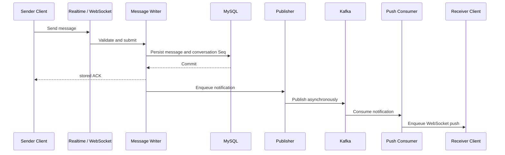

# IM — Real-time Messaging System

<p align="center">
  <strong>A Go-based real-time messaging backend focused on message delivery, per-conversation ordering, offline synchronization, and transactional workflows.</strong>
  <br />
  <sub>基于 Go 的实时通信系统工程实践，重点探索消息可靠投递、会话内有序、离线同步、群聊推送与红包资金处理。</sub>
</p>

<p align="center">
  <code>Go</code> · <code>go-zero</code> · <code>MySQL</code> · <code>Redis</code> · <code>Kafka</code> · <code>WebSocket</code> · <code>etcd</code>
</p>

---

## Overview

IM is a learning-oriented backend project for one-to-one and group messaging. It focuses on the engineering problems behind a real-time messaging service rather than only implementing chat APIs:

- Persist messages before acknowledging the sender.
- Maintain an independent, increasing `Seq` for each conversation.
- Deliver online notifications asynchronously through Kafka.
- Recover messages missed by real-time push through cursor-based synchronization.
- Keep WebSocket writes serialized and connection queues bounded.
- Handle red-packet operations with database-backed idempotency and transactional balance records.

这是一个持续迭代的工程实践项目。项目更关注消息链路、数据一致性和故障边界，而不是单纯堆叠业务功能。

## Architecture

### Message delivery



The sender's `stored` acknowledgment means the message transaction has committed. It does **not** mean that every recipient has received or processed the message.

If a notification is delayed or missed, the client can synchronize from its last known conversation `Seq`. MySQL remains the source of truth; Redis is used as a recoverable cache, not as the final record of a message.

### Core engineering decisions

| Area | Implementation |
| --- | --- |
| Message persistence | MySQL transaction commits the message and its conversation sequence together |
| Conversation ordering | Each conversation owns an independent monotonically increasing `Seq`; there is no global message sequence |
| Batch writing | Ordinary messages are grouped by shard; a batch can persist messages from multiple conversations while preserving each conversation's sequence range |
| Async notification | Kafka distributes post-commit notifications to push consumers |
| WebSocket writes | A single write loop serializes data and control frames for each connection |
| Offline synchronization | Clients use a conversation sequence cursor to fetch messages missed by real-time delivery |
| Group recipient cache | Process-local bounded cache with Redis Pub/Sub invalidation and a short absolute TTL; used for push recipient lookup, not authorization |

## Red-packet workflow

The project also implements red-packet workflows for one-to-one and group conversations:

- Validate the sender, conversation, amount, and request idempotency.
- Store monetary values as integer cents.
- Persist balance changes and ledger records transactionally in MySQL.
- Use Redis as a candidate-share acceleration layer, with MySQL checks deciding the final claim result.
- Handle expiry and refund through database-backed state transitions.

Redis is not the financial source of truth. Cache loss or stale candidates must not create duplicate claims or change account balances.

## Technology stack

- **Language:** Go
- **Service framework:** go-zero
- **Storage:** MySQL
- **Cache:** Redis
- **Messaging:** Kafka
- **Realtime transport:** WebSocket
- **Service discovery / RPC:** etcd, gRPC
- **Object storage:** MinIO
- **Testing:** Go tests, isolated integration checks, browser-based acceptance checks

## Local development

The repository provides a local dependency environment through Docker Compose.

```bash
docker compose up -d
go mod download
go test ./...
go build ./...
```

Service-specific configuration files under `service/*/etc/` are local development files and are not committed. Configure the required service settings and environment variables before starting the Go services. The Compose defaults are intended for local development only; do not expose the stack directly to the public internet.

## Validation notes

The repository includes acceptance reports and repeatable checks for message persistence, sequence continuity, red-packet accounting, cache invalidation, Kafka notification behavior, and receiver-side delivery.

A local load-validation round recorded on 2026-11-09 processed 36,000 messages at 300 messages/second across a hot-conversation scenario and a 20-conversation scenario. All messages in those runs received a `stored` acknowledgment, were observed by the test receiver, and were recoverable through offline synchronization. Receiver-side P95 latency was approximately 102 ms and 238 ms respectively.

These are results from a controlled, single-host development environment—not production capacity guarantees. The reports also document failed experiments, workload limits, and untested failure scenarios.

## Engineering notes

- [Message batching design](message-batching-design.md)
- [Message push pipeline](message-push-pipeline-design.md)
- [Message push performance report](message-push-pipeline-performance-report.md)
- [Group member cache design](group-member-cache-design.md)
- [Group member cache performance report](group-member-cache-performance-report.md)
- [Red-packet design and failure boundaries](redpacket-design.md)
- [Acceptance report](acceptance-report.md)
- [Load test report](load-test-report.md)

## Project boundaries

This is an actively evolving engineering project, not a claim of production readiness. The current validation is primarily local and single-node. Multi-instance connection routing, cross-node push delivery, long-running soak tests, production-grade high availability, and several broker / database failure-injection scenarios remain outside the verified scope. Consult the linked design and test reports for the exact coverage of each change.
