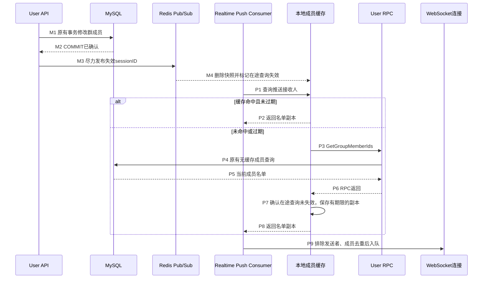

# 群消息推送成员缓存（2026-11-09）

本阶段参考 OpenIM 的进程内成员缓存和 Redis 删除广播：缓存命中直接获得推送接收人，未命中继续通过 User RPC 查询 MySQL。发送权限、离线同步权限和红包领取资格继续走原有校验；消息与 Seq、红包资金事务、Kafka offset 和发布方式沿用现有实现。

## 与 OpenIM 的对应关系

核对版本固定为 OpenIM Server `9502a1a15fe63f6342fb1e2d8068346a82f278d8`。

| OpenIM 实现 | 本阶段采用 |
|---|---|
| [GroupLocalCache.GetGroupMemberIDs](https://github.com/openimsdk/open-im-server/blob/9502a1a15fe63f6342fb1e2d8068346a82f278d8/pkg/rpccache/group.go)，本地未命中再调用群服务 | Realtime 的 `CachedGroupMembers.GetGroupMemberIds` 包装原 User RPC，仅给 Push Consumer 使用 |
| Redis 删除广播及本地订阅清理 | 群操作提交后发布 sessionID；每个 Realtime 独立订阅并清理自己的缓存 |
| 配置容量与过期时间 | 有界 LRU，默认 1024 会话，绝对 TTL 5 秒；缓存命中不续期 |
| 群服务内 Redis 成员缓存 | 本阶段没有增加第二级名单缓存，User RPC 仍直接查询 MySQL；先验证减少远程调用这一项收益 |
| MsgTransfer 批处理、MongoDB 异步存储 | 本阶段只借鉴成员缓存，保持本项目 MySQL stored ACK 与资金事务边界 |

之前的分段测量表明，热门会话的逐条群成员 RPC 平均约 2.95ms。缓存用于减少重复远程查询；它不表示取消 RPC 服务边界，也不表示这个时间全部来自网络。

## 实际入口

- `common/groupmembercache/local.go`：`Local.Get`、`Invalidate`、`SetAvailable`，缓存、并发查询合并、失效与重连处理。
- `common/groupmembercache/invalidation.go`：`Notifier.Invalidate`、`Subscribe`，发布与订阅。通知只携带 sessionID，不携带成员名单、聊天内容或鉴权信息。
- `service/realtime/internal/consumer/group_member_cache.go`：`CachedGroupMembers`，缓存未命中才调用原 `GetGroupMemberIds`。
- `service/realtime/realtime.go`：只给 Push Consumer 接入这个 provider；`svcCtx.UserRPC` 继续供发送与其他校验使用。
- `service/user/api/internal/logic/group/member_cache.go`：`notifyGroupMembersChanged`，使用独立 1 秒超时，在请求取消后仍尽力通知。
- `CreateGroup`、`InviteGroupMembers`、`LeaveGroup`、`KickGroupMember`：`WithTransaction` 成功返回后、原有 model 缓存清理前发布通知，避免原有缓存清理错误阻断通知。邀请/退出/移除没有实际变化时不通知。

当前仓库未找到解散群的业务写入口。以后新增改变群成员的写入口，也必须在提交后接入失效；直接 SQL 修改不会自动广播，依赖过期刷新。

## 主链及边界



- **M1 失败或 M2 结果未知**：沿用原业务返回错误，不发送成功通知。MySQL 可能在 COMMIT 结果未知时已经提交；本地名单靠 TTL 刷新。没有新增任何数据库结构。
- **M3 发布失败、进程在 M2 后崩溃、M4 通知丢失**：已提交成员状态不回滚；记录通知错误，旧快照按绝对 TTL 到期。通知不落 Outbox，也不承诺可靠投递。
- **M4 在 P3～P7 期间到达**：标记该次查询为失效，旧结果既不填缓存，也不作为这次查询的成功返回；在原调用期限内重新获取。并发等待者会跟随重新读取。
- **P3 返回错误/空响应**：错误不缓存，Push Consumer 返回错误，进入原有重试规则；真实空成员列表是成功结果，可以缓存。
- **订阅初次建立前**：本地缓存不保存结果，通过 RPC 读取。Redis 客户端自动重订阅成功时，清空所有旧快照及在途结果，避免沿用断线期间的缓存。
- **P2/P8 已经返回、随后发生成员变化**：已经取得的接收人快照不会被撤回。正常通知存在传输/调度窗口，丢通知可产生最长一个配置 TTL 的缓存陈旧窗口，之后还需一次成功 RPC 才能获得新名单；不能宣称踢人后所有连接立即停止接收。重连健康检查不是实时故障检测。
- **P9 入队或网络发送失败**：继续沿用现有尽力推送与主动 Seq 同步，不重新定义客户端收到确认。

`Local.Get` 在查询开始时计算过期点，慢查询不会在返回时重新获得完整 TTL。返回值复制，避免调用方改坏缓存；单名单超过 10000 个 ID 时只返回、不存入 LRU。缓存最多配置会话数个名单，查询失败不保存错误结果。

## 配置与上线顺序

Realtime 示例新增：

```yaml
GroupMemberCache:
  Disabled: false
  TTLSeconds: 5
  Capacity: 1024
  Channel: im:group-members:invalidate:v1
```

User API 示例新增相同 `Channel`。同一部署的 API 与 Realtime 必须使用相同 Redis Pub/Sub 服务和频道；Redis Pub/Sub 不按逻辑 DB 隔离，不同部署应配置不同频道。省略配置使用上述默认值，无需覆盖本地私有 YAML。

先升级带提交后通知的 User API，再启用 Realtime 缓存。只启动新 Realtime 而继续使用旧 API 时，成员变化依赖 5 秒 TTL。将 `Disabled: true` 后重启 Realtime 可以退回逐条成员 RPC，不涉及数据迁移。

## 验证

单元测试覆盖绝对过期、LRU 容量、错误不缓存、空名单、返回副本、并发合并、等待取消、查询期间失效和订阅未就绪降级。Push 测试确认同群重复消息只查询一次，成员变化失效后推给新名单，查询失败仍返回错误。

群操作事务测试分别覆盖建群/邀请/退出/移除的提交、回滚、COMMIT 结果未知、通知失败、无实际变更；用 SQL mock 的严格调用顺序确认通知在 COMMIT 之后。原有 model 缓存清理故意失败时，新的名单失效仍已发出。

真实 Redis 验证采用独立频道和两个缓存实例，测试广播失效、仅断开测试专属订阅连接后的自动重订阅清理，以及故意漏发通知后的 TTL 恢复。不会停止共享 Redis 或清空其他数据。

功能验收后完成了缓存开启/关闭的有界对照，结果和限制见 [性能与验收报告](group-member-cache-performance-report.md)。

## 本阶段决策

做了什么：采用 OpenIM 的本地名单复用与广播失效，减少群聊热路径上的重复 RPC，并保留短 TTL 兜底。

为什么：已有测量定位到逐条查询成本；先减少重复工作，便于独立评估收益，再判断是否需要 offset 批量提交和发布批量化。

失败边界：推送接收人采用可短暂陈旧的快照；发送权限与红包领取权限不使用该缓存，资金与消息持久化边界保持原规则。用户接受本阶段缓存方向，不等于资金权限可以采用最终一致的名单。
