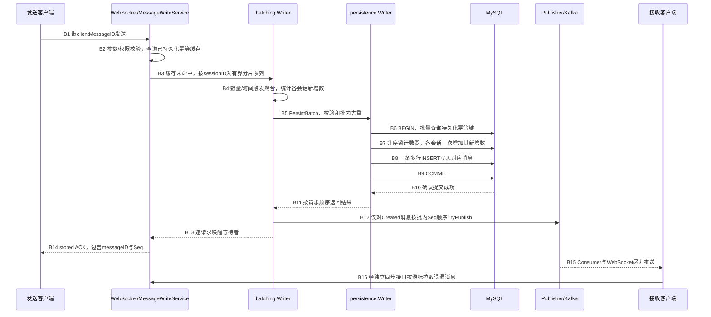

# 普通消息会话批处理：实现与失败边界

日期：2026-11-09。用户选择保留 MySQL 事务内 Seq，并授权实现核心逻辑；本轮不执行压力测试。

后续用户另行授权性能对照，已完成两轮真实消息链路测试，见 [性能报告](message-batch-performance-report.md)。本文“不执行压力测试”与验证记录指首次实现阶段；对照观察到持久化收益，但实时推送未等比例改善。

同日后续推送优化将默认事务范围扩大到同一分片批次的多个普通会话，并批量更新计数器；下面的调用和配置已更新。早期验收结果保留其原范围，后续实现与测试见 [链路优化设计](message-push-pipeline-design.md)。

## 参考与适配

参考 OpenIM 的 [OnlineHistoryRedisConsumerHandler](https://github.com/openimsdk/open-im-server/blob/main/internal/msgtransfer/online_history_msg_handler.go) 与 [Batcher](https://github.com/openimsdk/open-im-server/blob/main/pkg/tools/batcher/batcher.go)：按会话 Key 分组、固定分片串行执行、按数量或时间触发批处理。本项目自行实现小型调度器，适配 MySQL 作为消息和资金事实源的约束。

普通消息经批处理器进入 MySQL；Redis 仍用于读取已持久化的幂等结果和消息缓存。红包资金事务直接使用同步 Writer。Kafka 是提交后的尽力通知通道。

## 实际调用与事务主线

B16 实际由 Offline HTTP 接口处理，图中 W 代表客户端访问的服务端入口。同步读已提交数据，实时推送不推进同步游标。

### 对应代码

- `service/realtime/internal/websocket/message.go:handleMessage`：保持权限校验与 stored ACK；普通消息的发布从逐请求 handler 移入批处理提交后。
- `service/message/application/message_write_service.go:MessageWriteService.Send`：验证命令、读取 Redis 已持久化幂等结果，未命中进入批处理 Writer。
- `service/message/batching/writer.go:Writer.Persist/run/process`：入队、分片聚合、事务调用、发布与逐请求结果返回。
- `service/message/persistence/batch.go:Writer.PersistBatch`：批内去重、批量持久化幂等查询、事务内分配连续 Seq、批量插入。
- `service/message/model/conversation_sequence/model.go:LockAndAddTx`：行锁内一次增加 N，返回本批最后一个 Seq。
- `service/message/model/conversation_sequence/batch.go:LockAndAddManyTx`：多会话按 ID 升序加锁，三次 SQL 批量分配各自 Seq 范围，与消息同事务。
- `service/message/model/message/batch.go`：批量幂等键查询与多行 INSERT，保留所有唯一约束。
- `service/redpacket/application/send_service.go:SendService.Send`：资金、红包、份额、流水、单条 Seq 和消息继续共用外层事务。
- `service/offline/internal/syncer/reader.go:Reader.Sync`：按原游标读取缓存，缺失回源 MySQL。

## Seq 与幂等不变量

1. 一批可包含同一分片的多个会话的普通消息；红包及外层事务不能被送到异步工作线程。多会话按计数器 ID 升序加锁，并分别分配连续 Seq。
2. 批内重复幂等键同内容复用结果，只有第一个新建结果为 `Created=true`；不同内容转为单请求确认，冲突明确拒绝。
3. B6 找到的已保存消息直接返回，不消耗 Seq；跨进程竞争仍由数据库唯一约束仲裁。
4. B7 一次为 N 条新消息增加 N，B8 写入对应的 N 条消息，B9 一起提交或回滚。未独立提交号段，也不在事务外预发号。
5. 同会话行锁持有到事务结束；后续普通消息或红包只能在当前事务结束后继续分配。正常新增路径保持连续，不把物理删除或人工改库造成的空洞归入该保证。
6. 内存中提前计算的结果只能在 B10 后返回。COMMIT 应答未知时，所有本批结果均按未知处理，客户端复用原幂等键查证。

## 队列、超时和关闭

`MessagePipeline.Batching` 是可省略的新配置，代码提供默认值，现有本地 YAML 无需迁移：

| 配置 | 默认值 | 含义 |
|---|---:|---|
| Workers | 8 | 固定分片工作线程，sessionID 的 FNV 哈希对工作线程数取模 |
| QueueCapacity | 256 | 每个分片的排队请求上限，另有最多一个活动聚合批次 |
| BatchSize | 32 | 一个工作线程每轮收集的最大请求数，默认共享一个普通消息事务 |
| FlushMillis | 2 | 从本轮首个请求开始的最大聚合等待；不包含排队和数据库耗时 |
| TimeoutMillis | 10000 | 每个聚合批次数据库处理期限，包含有限重试或拆分处理 |
| SeparateConversations | false | 设为 true 回退到按会话分别执行事务 |

不同分片可并行；落入同一分片的不同会话也会互相等待。工作线程不是每会话独立启动，避免无界 goroutine 和队列。

共享事务还意味着一个会话遇到数据库故障时，同批其他会话的新增写入一起回滚；这不会产生部分提交的 Seq。批内语义冲突仍按原错误分类拆分，未知提交结果不拆分。

B3 队列满会立即返回 `ErrQueueFull`，WebSocket 沿用暂时不可用响应，不返回 stored。开始处理前发现调用上下文已过期，则丢弃该排队请求，不分配 Seq。

批事务开始后，采用保留上下文值、独立受限的处理上下文，避免某个客户端取消导致其他请求一起回滚。调用方超时可能早于实际提交；即使等待者已离开，B12 仍会为确认提交的新消息尝试通知。客户端必须以原 `senderID + clientMessageID` 重试确认。

退出时 `BatchWriter.Close` 拒绝新入队，排空已接收请求，跳过已过期的队列请求。内存队列不提供进程崩溃后的重放能力，尚无 stored 的请求由客户端重试。

## 故障边界

| 步骤/故障 | MySQL事实与部分成功 | 客户端结果 | 恢复与幂等键 |
|---|---|---|---|
| B3 队列满或处理前取消 | 新请求尚未开始持久化 | 暂时不可用或超时；无stored | 原senderID+clientMessageID重试 |
| B5 批内语义冲突 | 尚无本批写入 | 拆为单请求确认，冲突请求拒绝 | 合法请求继续；冲突请求不换键伪装重试 |
| B6 发现已有消息 | 旧消息保持存在，不增加计数器 | 原messageID+Seq | 返回原持久化结果 |
| B7/B8 错误并确认回滚 | 本批新增消息、计数器整体回滚 | 无stored | MySQL 1213死锁最多整批重试一次，重新读取计数器 |
| B8 唯一键碰撞 | 先回滚本批，无部分新增提交 | 逐请求回查或写入确认 | 新事务使用原幂等键；其他唯一约束冲突仍报告不变量故障 |
| 拆分处理中基础设施出错 | 之前已独立提交的请求保留，后续请求停止尝试 | 已提交者成功，其余暂时不可用 | 避免数据库故障时逐条放大流量；原键重试 |
| B9 COMMIT结果未知 | 可能整批已提交，也可能未提交；不自行假定回滚 | 暂时不可用或超时；不发确认结果 | 不自动拆批重写，原键重试查询数据库确认 |
| B10后、B14前进程崩溃 | 本批完整提交，ACK可能未收到 | 发送方状态未知 | 原键查证，接收方按Seq同步 |
| B12/B15通知丢失 | 已提交消息不受影响 | stored仍有效 | 客户端触发同步恢复内容，不保证重放Consumer或实时通知 |

## 红包协调与顺序范围

红包仍在原资金事务中调用 `Writer.Persist(txCtx, command)`，其 `LockAndIncrementTx` 复用同一个 `LockAndAddTx(...,1)`。普通批次先占用行锁则先获得连续区间，红包先占用则先获得一个编号。任何资金事务错误继续整体回滚。

本实例普通消息的 B12 按新消息的批内 Seq 顺序入发布队列，重复请求不额外发布。红包与其他实例各有 Publisher，未新增跨进程发布顺序协调；不能由Kafka的相同Key推导全局Seq发布顺序。客户端仍按Seq排序、messageID去重，且只在同步保存完成后推进游标。

当前单条WebSocket连接仍按连接串行处理业务请求，同一连接逐条等待结果时不一定形成大批。聚合收益主要依赖多个发送连接的并发负载。

## 验证范围与取舍

功能测试覆盖一次计数器更新和多行INSERT、批内重复与已保存幂等、回滚不返回结果、重试重新分配、Seq溢出、队列上限、关闭、分片并行、请求取消、批内冲突隔离、未知COMMIT不重写、提交后通知失败仍返回stored，以及未收到任何通知时按Seq分页恢复本批消息。

SQL功能测试使用sqlmock，不等于真实MySQL事务/网络故障验收。另提供 `TestBatchAndRedPacketSeqSyncRealDatabase`：在明确提供可丢弃MySQL测试库时，验证普通批次、失败回滚、红包、后续批次和无缓存分页同步。通过 `IM_ISOLATED_ATOMIC_TEST_DSN` 配合 `-tags integration` 单独运行。

本轮执行结果：`go test ./... -timeout 90s` 通过；`go build ./...` 通过；`git diff --check` 通过。新集成测试以 `-tags integration -run '^TestBatchAndRedPacketSeqSyncRealDatabase$'` 编译并执行，但因未提供独立MySQL连接而跳过。Docker当前未启动，没有启动基础设施或修改运行中数据库。

本轮不执行压力测试；没有批处理前后吞吐、P95或容量结论。实际收益是减少普通消息的计数器更新、INSERT语句和逻辑事务提交次数；代价是聚合等待、分片队列和批内失败处理。原Kafka Publisher仍逐条同步发送，本轮未调整其吞吐。

决策：借鉴会话批处理结构，保持MySQL事务与Seq补漏依据。原因：减少逐条数据库开销，同时复用红包原子性和现有同步协议。失败边界：队列与Kafka通知均不持久可靠，stored只承诺MySQL已提交；客户端以原幂等键确认发送，以同步游标恢复内容。
