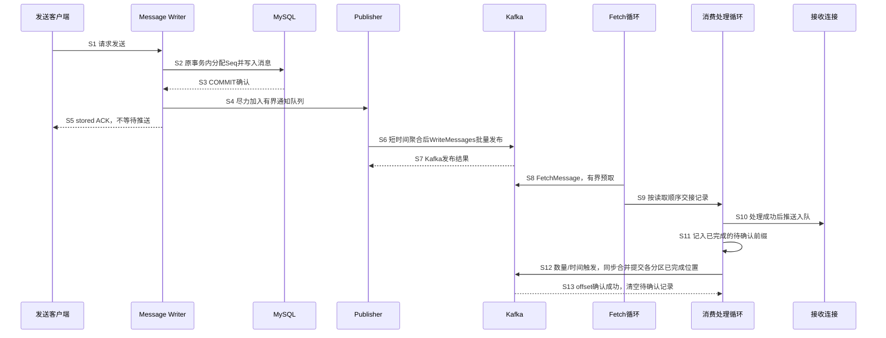

# 消息推送链路优化（2026-11-09）

用户授权将剩余性能优化合并推进，并以接收方实际收到消息的结果验收。本阶段保留 MySQL 同步持久化、提交后 stored ACK、后台 Kafka 通知和 Seq 主动补漏；增加小批量发布、批量 offset 确认、有界预取，修正 Realtime 日志初始化，并合并普通消息跨会话写入的 SQL 往返。

## 改动入口

- `common/messagepublish/publisher.go`：`NewWithConfig`、`run`、`publishBatch`、`Close`。
- `common/messagepublish/config.go`：发布数量、聚合等待和有界队列配置。
- `common/kafkareader/batch_config.go`：批量确认数量和时间配置。
- `service/realtime/internal/consumer/batched_reader.go`：`RunKafkaConsumerBatched`、`fetchRecords`、`processRecord`、`commitBatch`。
- `service/realtime/realtime.go`：正式运行调用批量消费循环，以 `logx.SetUp(c.Log)` 初始化日志，退出时先排空 DB Writer，再限时排空 Publisher。
- `service/message/batching/writer.go`：同一分片聚合批次共享普通消息事务，使用会话 ID 的 FNV 哈希选择分片。
- `service/message/model/conversation_sequence/batch.go`：多会话计数器按 ID 升序加锁，以三次 SQL 完成整批计数器创建、读取与更新。
- `service/realtime/internal/websocket/client.go`、`message_push_consumer.go`：逐条接入/推送摘要改为 debug 日志，接入日志只记录用户 ID 和帧长度。

原 `RunKafkaConsumer` 保留作回退路径及旧故障测试。普通消息批事务扩大到同一分片的多个会话；红包资金仍走原有独立事务，成员权限规则、协议和客户端同步游标不变。

## 普通消息写入合并

持续流量测试发现，多会话场景仍为每个会话单独提交事务、分别执行计数器 SQL，客户端收到消息的延迟随 stored ACK 一起增加。现在同一分片收集到的普通消息共享一次事务：批量查幂等键，按会话统计新增条数，升序批量确保计数器行存在，再 `FOR UPDATE` 读取并用一条 `CASE` 更新，最后多行插入消息并提交。仅一个会话时仍走原计数器方法。

各会话分别获得连续 Seq 区间，重复请求不耗号；任意计数器或消息写入失败，整批一起回滚。多个会话共享了故障和等待范围，所以保留 `Batching.SeparateConversations: true` 回退到每会话独立事务。未知 COMMIT 不自动拆分重写，原有幂等键查证方式不变。红包通过同一计数器行锁与普通批次协调，资金不会加入普通消息批次。

分片不再直接对 Snowflake ID 取模，以避免低位相同的真实会话 ID 集中到一个工作线程。性能测试会话 ID 原本连续分布，因此不能将已观察到的慢请求归因于该问题。

## 主链



S5 与后台 S6～S10 的实际调度可以交错。图中不表示发送方一定先收到 ACK，接收方才收到消息。

## 失败边界

- **S3 前失败**：沿用现有事务/幂等语义。本阶段没有改变 Seq 与消息同事务提交的规则。
- **S4 队列满或 S6/S7 发布失败**：已提交消息仍存在，stored ACK 语义不变。通知继续尽力发送，内容依赖主动 Seq 同步恢复；不保证最后一条漏通知能够自动被在线客户端发现。
- **S6 批量出现部分成功或结果未知**：不新增整批重新排队，以免重排和扩大重复；Kafka 客户端自身仍有重试，可能产生重复。新代码记录批大小、首消息 ID 和错误；不能把一次 `WriteMessages` 调用当成跨分区原子事务。
- **S8 网络错误**：沿用退避重试。明确关闭、组代次变化等错误停止对应循环并上报。预取不是确认，预取记录不会提前推进 offset。
- **S9/S10 临时处理错误**：停留在当前业务记录重试，不处理后续记录。预取循环最多占用一个配置大小的应用缓冲区，另可有正在交接的 Fetch 结果；Kafka 客户端本身还有内部缓冲。
- **S10 永久处理错误**：仍须先可靠进入 DLQ，再将该原记录视为处理完成；DLQ 失败阻塞当前业务处理。没有按重试次数自动跳过。
- **S11/S12 中途崩溃或退出**：成功处理但未确认的记录会重放，客户端按 messageID 去重。批量确认扩大了重放窗口，不提供客户端恰好收到一次的承诺。
- **S12 临时失败**：重试同一组已完成位置，期间不再次执行业务处理，也不处理后续记录；不能因提交失败重新推送整批。消费组代次失效时停止服务消费并保留重放可能性。

`processRecord` 仍是单循环、串行业务处理。每个分区的最高提交位置只从已经完成的 `pending` 记录中选择。例：同分区 offset 10 成功、11 失败时，12 即使已预取也不会被处理或提交，因此不会越过 11。

时间触发在空闲时也会执行，最后一小批无需等待下一条消息才确认。业务重试、DLQ 重试和同步提交本身可以超过配置间隔；该间隔不是严格的确认时间上限，也不代表当前消息要等待它才推送。

## 配置与回退

```yaml
MessagePipeline:
  Batching:
    SeparateConversations: false
  Publishing:
    BatchSize: 32
    FlushMillis: 1
    QueueCapacity: 512
  ConsumerCommits:
    Disabled: false
    BatchSize: 32
    IntervalMillis: 10
```

省略时使用上述默认值，旧私有配置无需重写。Publisher 的应用聚合与 Kafka Writer 内部聚合分别采用短等待；不能据此承诺所有请求的排队上限为 1ms。

将发布 BatchSize 设为 1、ConsumerCommits.Disabled 设为 true，可退回逐条发布/确认方式。源码完整备份为本机 `im-push-pipeline-backup-20261109-204320`，已经包含上一阶段成员缓存和批量写入。

## 日志初始化修正

采样发现 Realtime 原来只加载 `ServiceConf`，没有初始化日志。即使 YAML 配置 `Log.Level: error`，实际仍输出每条 SQL 和推送 debug 日志。当前仅执行 `logx.SetUp(c.Log)` 使日志配置生效，避免整套 `ServiceConf.SetUp()` 额外开启原服务没有启动的运行时组件。异常日志保留，正常逐条帧和推送摘要只在 debug 级别输出。

最终性能对照包含此修复和普通消息写入合并，不能将全部收益归因为 Kafka 批量化。原始中间结果均保留，包括日志初始化修正前的 `im-push-pipeline-burst-20261109_205622`、采用整套 ServiceConf 初始化的 `..._210120`，以及持续流量中出现过载的版本。最终结果以性能报告指明的运行目录为准。

## 验证策略

- 单元测试验证多分区最高已完成位置、空闲尾批确认、临时业务/提交错误、DLQ ACK 前不提交、组代次变化停止、Publisher 批量顺序和关闭后拒绝。
- 真实 MySQL 验证多会话提交、插入后注入错误导致整批回滚、重试无空号、重复请求不耗号，以及普通消息和红包交错写入后的 Seq 分页同步。
- 真实 Kafka：同组停止后重新启动，确认未确认前缀重放；注入一次提交失败，验证重试提交没有重复执行业务。
- 真实 MySQL/Redis：建群、邀请、踢人、退群业务逻辑提交后刷新两个接收人缓存；该项没有绕过既有事务 SQL。调用业务逻辑进行集成测试，不冒称完整群管理 HTTP/前端验收。
- 同环境备份二进制与当前版本做两轮交错突发对照，另做固定发送速率的持续对照。正式统计接收端到达时间、未实时到达数量及 Seq 内容恢复结果；不以 stored ACK 完成速率代表推送容量。

## 本阶段决策

做了什么：合并普通消息事务、计数器 SQL、发布和 offset 往返；预取有界，继续顺序执行业务，并使已有日志配置真正生效。

为什么：已有分段数据表明逐条发布、逐条确认和重复日志位于消息热路径。先减少这些固定成本，再根据持续流量下的实际结果判断容量边界。

失败边界：数据库成功事实、尽力通知和客户端真正收到依然分开；批量操作增加可能的通知重复/重放窗口，失败记录不能被更高 offset 越过。本阶段不把消息事实迁到 Redis/MQ，不改变红包资金提交边界。
