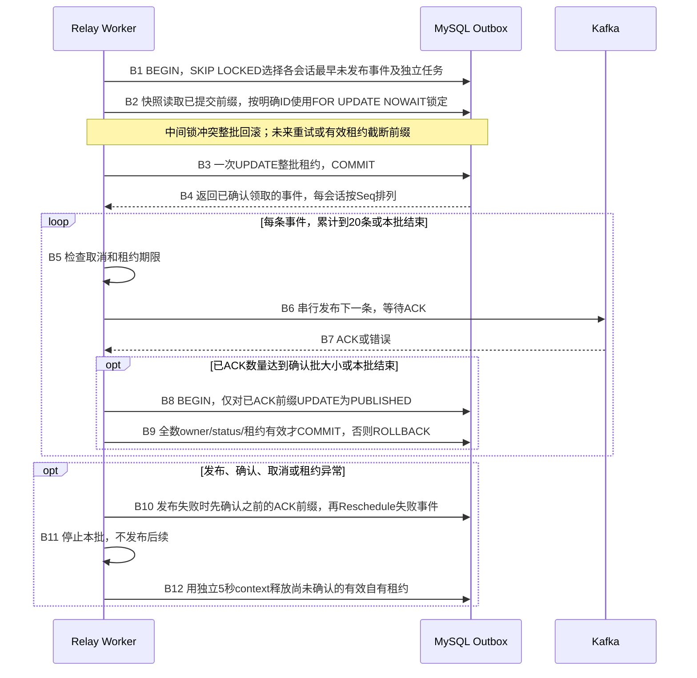

# Relay 连续领取和批量确认（2026-10-06）

## 设计与准确性边界

用户认可连续 Seq 批量领取，并要求扩大领取尺度以提升吞吐。本轮增加同会话连续领取、一次写整批租约和已 ACK 前缀的批量确认。示例 `BatchSize=500`，可配置 1～2000；`CheckpointSize=20`，可配置 1～BatchSize。仍要求单个有效 Relay，租约 120 秒，无续租和 fencing token。

### 为什么不会因批量操作把未完成任务丢掉

- **B1～B4**：先锁每个会话最早未发布事件，该事件之前不能有任何未发布事件；再用普通MVCC查询读取已提交的未发布前缀，不包含Writer尚未提交的尾部插入。快照遇未来退避/有效租约截断，然后按这些明确ID加锁，锁后再次检查状态、重试时间和租约。扩展锁查询不使用 SKIP LOCKED，不能省略已有但被锁住的中间 Seq。遇到中间锁冲突整批回滚，不返回事件。所有选中事件一次更新租约、同事务提交；结果未知不发布，由租约恢复。
- **B6～B9**：Kafka 仍逐条同步 ACK，批内每会话保持 Seq 顺序；在拥有同批租约期间允许先发布多条，再一次回写已 ACK 前缀。确认时任何一行的处理权失效，都回滚整个确认事务。尚未收到 ACK 的事件不能进入确认列表。
- **B10～B12**：发布失败或 ACK 未知停止整批，包括其他会话尚未处理的事件，以简化恢复。已成功 ACK 的前缀先尝试确认，失败事件安排退避；释放只更新自有、未过期的 PROCESSING 行，不修改已发布、已重排或新持有者的记录。确认结果未知可能造成重复发布，业务 ID 不变。
- **B12 失败或进程直接消失**：记录仍在 MySQL，PROCESSING 租约到期后恢复。正常取消仍尝试独立 5 秒清理；进程被强制终止时不会执行清理，必须等待持久租约恢复。

扩大领取和批量确认增加重复投递窗口：已 ACK 的事件在确认前宕机，会一起重放。确认块最多 20 条，已确认块不需要重放；严格说只约束当前进程正常串行执行时的窗口，不消除 ACK 未知或租约接管的重复。两个存活 Relay 在 Kafka 调用跨越租约时仍可能相互穿插，本轮不提供多实例严格顺序承诺。

低负载不等待凑够 500 或 20 条：实际可领多少就取多少，批尾立即确认余下 ACK 前缀。没有额外攒批计时器。

### 成本与取舍

全局最多 500 条，同一热门会话可以占用剩余批次额度；所有会话的首条先进入结果，再按最早首条的会话顺序追加前缀。批内会话之间公平性有限。内部锁冲突会使整批暂时回滚，故障时整批停止；这是当前单 Relay 实现为简单恢复接受的可用性取舍。

持久化 Seq 与资金事务没有改动。消费者幂等、客户端按 messageID 去重和同步游标规则继续生效。索引沿用上一轮，无新增表或 Redis 协调锁。

## 验证

单元测试：发布 ACK 未知时只确认已 ACK 前缀、不发布后续；确认失败和 COMMIT 响应丢失时恢复；取消后独立释放；释放失败和租约过期保留恢复记录。

真实 MySQL：原索引和覆盖索引均验证前序锁竞争、中间锁冲突整批回滚、未来重试或有效租约截断前缀、确认原子性和租约状态约束。600条同会话事件测试确认首批准确领取500条，尾部100条被前序租约阻挡，确认前序后下一批从Seq501开始。发布故障由测试 Publisher 注入，实际 Kafka 故障/精确 COMMIT 响应丢失未在真实网络中注入。最终代码 `go test ./...`、`go build ./...` 和 MySQL 集成测试通过；未运行 race detector。

还模拟了领取后进程消失但不释放：租约有效时新持有者不能领取，到期后可重新领取完整前缀，旧持有者无法回写或释放新租约。这验证数据库恢复机制，未运行两个存活发布者测试 Kafka 接管顺序。

### 复测发现的 WebSocket 心跳阻塞

第一轮批量测试 `im-load-20261006_093507` 在20会话/100并发阶段，两条发送连接出现读超时。原读循环同步执行 `handleMessage`，慢事务期间无法读取控制帧；Ping周期54秒、Pong期限60秒，事务可能占用这6秒窗口。Node内置WebSocket会自动回Pong，但服务器业务处理阻塞读取。压测程序随后反复使用关闭连接，导致502次 `connection_closed`，因此这轮不是容量通过。

修复：读循环处理帧并将业务消息送入16条有界队列，独立处理循环按连接串行执行业务；队列满关闭连接，未确认请求仍需原clientMessageID查证重试，不假报成功。没有延长心跳/请求超时。新增真实WebSocket测试：阻塞第一个业务请求，同时发送后续请求和Ping，仍能及时收到Pong，解除阻塞后请求顺序保持1、2、3。关闭连接后不启动排队请求，已执行的事务仍可能提交。

压测客户端在连接关闭后停止该发送worker，避免用瞬时错误耗尽请求预算。失败轮原始数据见 [初轮记录](scripts/relay-batch-initial-results-20261006.json)。最终对照还包含此心跳修复，需明确这一额外变量。

### 排除尚未提交尾部的领取冲突

心跳修复后的中间轮 `im-load-20261006_094040` 请求及资金/Seq核查通过，但Relay有82次NOWAIT锁冲突回滚，后续重试恢复。范围锁查询会碰到Writer的尚未提交尾部；改为B2先用快照物化已提交前缀，再按明确ID锁定。新增MySQL测试在另一个事务中插入并持锁一个未提交尾部，仍可领取完整已提交前缀；已存在的中间记录被锁住时继续整批回滚。中间轮数据保留在 [领取冲突记录](scripts/relay-batch-contention-results-20261006.json)，其指标不是最终版本指标。

## 负载对照

对照上一轮 `im-load-20261006_090950`（覆盖索引、每会话每批一条、总上限100、每条回写），本轮从新库和独立 Topic 运行。两轮每组600条、阶段排空、相同连接池与串行 Kafka ACK；本轮同时改变了连续领取、租约批写、确认批写和上限500，不能单独归因于其中一项。另增加20条低负载观察，单并发、等待收到后间隔200ms继续；样本少，不作为长期容量保证。

最终版本复测为 `im-load-20261006_094720`，结果 **COMPLETED_WITH_REQUEST_ERRORS**。13组共15,960次请求出现1次消息写入超时，另20次低负载观察全部成功。前一轮通过但存在82次领取冲突的数据保留为中间版本，不能替代最终结果。

| 场景（每组600次尝试） | 原推送P95/ms | 本轮推送P95/ms | 本轮stored ACK P95/ms | 本轮成功数 |
|---|---:|---:|---:|---:|
| 单会话，10并发 | 7322.82 | 320.28 | 269.41 | 600 |
| 20会话，10并发 | 6013.58 | 663.63 | 222.16 | 600 |
| 单会话，50并发 | 7457.72 | 2150.53 | 2109.25 | 600 |
| 20会话，50并发 | 7550.22 | 3882.59 | 590.33 | 600 |
| 单会话，100并发 | 9634.52 | 4115.29 | 4079.94 | 599 |
| 20会话，100并发 | 9809.44 | 3732.45 | 1337.69 | 600 |

推送延迟从客户端开始发送到观察连接首次收到计算，包含权限校验、事务排队、落库、Relay和消费，不是纯Kafka耗时。百分位只统计成功请求，单会话100并发的599条不能作为600条全部成功的性能保证。多个场景发送ACK没有改善，吞吐仍受写入和共享数据库负载影响。

低负载20条样本：stored ACK P95为45.52ms，推送P95为232ms、最大293.65ms；空闲轮询仍为200ms，没有延长攒批时间。样本较少且本机Docker共用资源，不代表生产环境长期SLO。

### 领取与回写成本

100并发热门会话观察窗口：有效领取从607次降到345次，累计领取耗时10.30秒降到6.14秒；确认事务从608次降到346次，累计耗时6.22秒降到3.84秒。20会话100并发最终窗口只有7次有效领取和33次确认事务。窗口中可能混入阶段边界其他事件，不把这些计时次数当作消息数。

500是上限，领取多少取决于当时已提交积压。热门会话的写入有串行点，最终轮经常只取到少量新事件，不能声称每次都领满500或一律减少20倍写入。真实MySQL的预置600条测试单独验证了500条领取能力。

### 剩余超时与正确性核查

唯一失败为单会话100并发的 `message_write_unavailable`，日志定位在发送者与clientMessageID的幂等查询，返回 `context deadline exceeded`；没有宣称该请求stored。服务停止后按原幂等键查询，数据库计数为0。连接池排队与热门会话锁等待是可能原因，当前没有逐请求池等待/锁等待测量，不能认定其中某项就是唯一根因。保持原10秒写入期限和连接额度，未通过放宽超时掩盖问题；客户端继续用原幂等键查证与重试。

资金核查：3个红包、121名用户余额与流水无差异；领取10/50/100并发各100成功、20已领完，离线同步12,000次成功。65个会话Seq检查、成功消息数量检查和观察连接的首次推送顺序检查无差异。最终3,698条Outbox全部PUBLISHED，无PENDING/PROCESSING/重试，已报告Kafka分区lag为0。Relay分段日志无领取、发布或确认错误；本轮无WebSocket心跳超时，但不据此承诺所有网络故障都不会漏实时通知。

原始导出：[负载与核查](scripts/relay-batch-results-20261006.json)、[Relay分段计时](scripts/relay-batch-timings-results-20261006.json)。业务测试服务已停止，隔离数据库、Topic和临时日志保留。本轮完成批量优化与已列测试，**没有完成100并发无错误容量验收**。

## 面试讲述

“最初Relay总批量100，但每会话只能领一条，热门会话反复执行领取和回写事务。我改为同事务领取已提交的有序前缀，上限500，批内逐条等待Kafka ACK，每20条确认已ACK前缀。中间锁冲突回滚，发布失败停止后续，未确认任务通过释放或租约到期恢复，接受重复并依赖幂等。固定600次尝试的本机测试中，100并发热门会话成功消息的推送P95约9.6秒降到4.1秒，但仍有1次写入超时，不能把延迟改善说成容量全部达标。”
