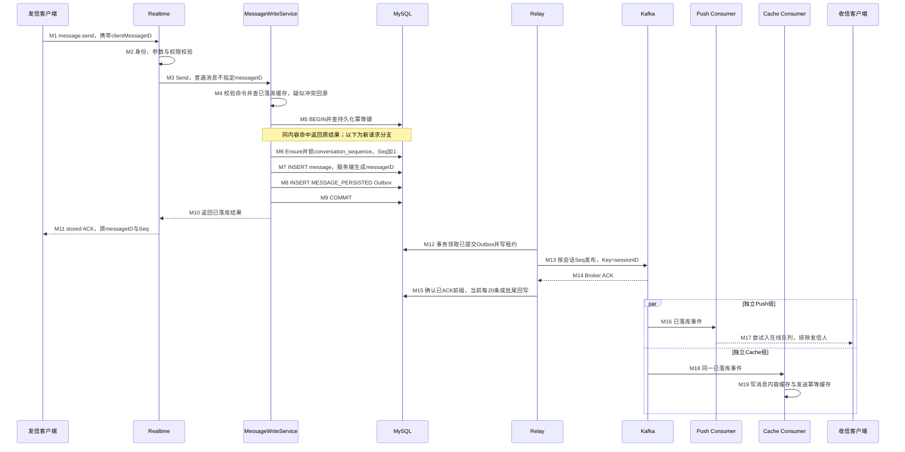
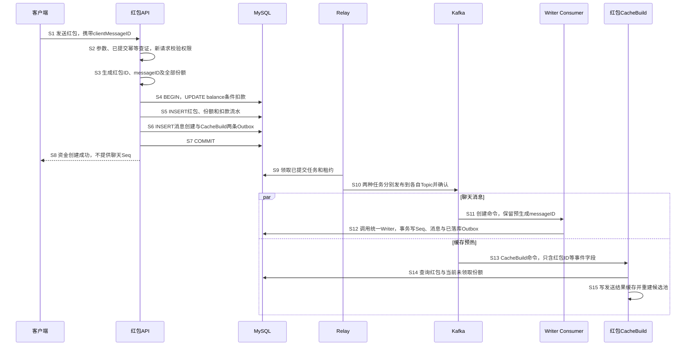
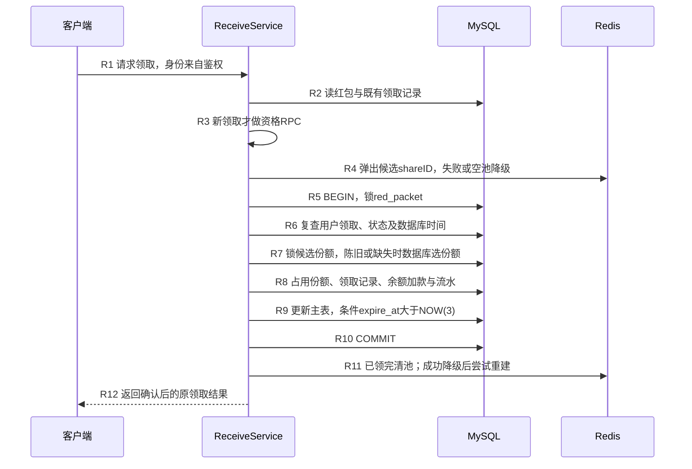
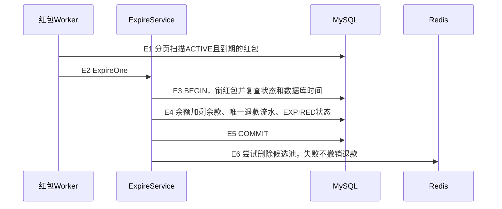
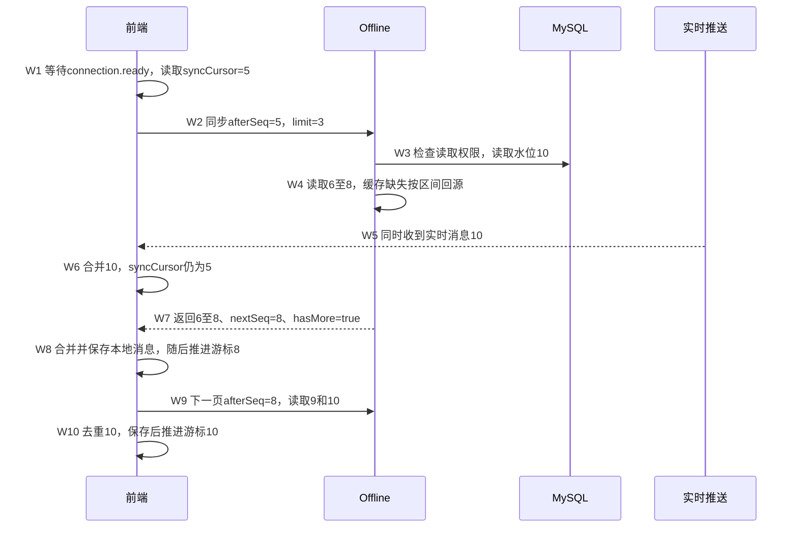

# 01 项目介绍与整体架构

截至2026-10-06。★表示必会题；问题编号用于跨文档复习。先练口述，再看图和代码。

## A01 ★ 请介绍一下你的项目

**口述回答：** 这是参考老师项目、结合AI实现和复盘的Go即时通信学习项目，包含普通聊天、离线增量同步和红包。重点是消息与资金的正确性：MySQL保存事实，消息事务同时写Seq、消息和Outbox；红包资金事务同时写资金记录和消息创建任务。Redis提供可丢弃缓存，Kafka传播提交后的事件，WebSocket提供实时通知。当前验证范围是单Realtime、单有效Relay和静态网关，我还做了故障验收与本机压测。

**展开：** 介绍顺序用“产品功能→核心机制→一个设计难点→验证范围”。挑双写、并发领取或Relay优化中的一个展开。第一次介绍不报全部端口和类名。

**追问：** 最难的部分是什么？你具体参与了什么？分别见B01、E01和F06。

**代码与证据：** [设计决议](../redpacket-design.md)、[真实验收](../acceptance-report.md)。

**容易说错：** 不把学习项目说成真实支付平台，不把AI实现的代码全部说成自己独立手写。

## A02 各服务分别做什么？为什么这样拆？

**口述回答：** User API和RPC管理身份、会话及成员资格；Realtime管理连接、普通消息入口和消息消费者；Message模块是被Realtime调用的统一写入代码，并不是另一个独立部署的消息RPC服务。Offline只读已落库消息。红包API负责资金请求，红包Worker做缓存构建、到期退款和候选池修复。Relay把Outbox可靠投递到Kafka，网关统一浏览器入口。划分依据是数据责任和执行方式。

**展开：** 代码模块、操作系统进程和数据库边界是三个概念。当前消息与红包相关表在同一个MySQL数据库，API通过各自事务写入；权限RPC与这些事务并不原子。

**追问：** Worker和Relay有什么区别？前者执行红包任务和资金退款，后者只搬运已提交Outbox，不决定领取和退款结果。

**代码与证据：** [Realtime启动](../service/realtime/realtime.go)、[红包Worker](../service/redpacket/worker/worker.go)、[Relay启动](../service/outboxrelay/outboxrelay.go)。

**容易说错：** 拆成多个进程不自动等于完成分库、多节点或高可用部署。

## A03 ★ 普通消息从发送到收到的完整链路是什么？

**口述回答：** 客户端通过WebSocket提交clientMessageID。Realtime鉴权并校验发送资格，调用统一MessageWriteService。服务先查已落库幂等缓存，未命中或疑似冲突回MySQL；新请求在一个事务里签发会话Seq、写消息和已落库Outbox，提交后返回stored。Relay随后发布事件，Push组尝试向收信人的在线队列发送，Cache组独立构建缓存；离线或未收到时通过同步补齐。

**展开：** 图示先画M11再画后台便于阅读，实际M9之后两者并发，推送可能先于发送ACK。Kafka消费者不等待M15才处理。Redis一致命中时可以不启动新的消息事务。

**追问：** stored代表对方收到吗？不代表；只代表已落库结果得到确认。M17入队也不代表客户端收到。

**代码与证据：** [普通入口](../service/realtime/internal/websocket/message.go)、[Send](../service/message/application/message_write_service.go)、[Writer](../service/message/persistence/writer.go)、[Push](../service/realtime/internal/consumer/message_push_consumer.go)。

**容易说错：** 不说普通消息先写Kafka再落库；当前已删除旧链路。M9未知的恢复见D01。

## A04 ★ 发红包的完整链路与普通消息有什么不同？

**口述回答：** 发红包先查发送幂等缓存和数据库，同内容重试返回原结果；新请求才校验权限、生成红包ID和消息ID并拆分份额。资金事务完成条件扣款、红包、份额、流水和两条Outbox。提交确认后就可以返回红包创建成功；聊天消息由创建命令异步交给统一Writer落库，另一条Outbox触发缓存构建。成功扣款与聊天消息出现之间允许延迟。

**展开：** S7是资金成功点，S12是聊天消息成功点。S7之后Relay可与S8返回并发，图按职责排列，不保证后台必定晚于客户端响应。消息创建与CacheBuild是独立任务，Consumer失败不会回滚S7；当前Relay本批异常会暂时停止其他任务，所以“独立职责”不代表完全没有调度影响。

**追问：** 资金成功但命令进入DLQ怎么办？资金事实仍在，消息补齐成为待修复事项，见D05。

**代码与证据：** [SendService.Send](../service/redpacket/application/send_service.go)、[缓存Consumer](../service/redpacket/worker/cache_consumer.go)。

**容易说错：** 两条资金Outbox中的CacheBuild不是第二段“已落库消息Outbox”；两段含义见B03。

## A05 ★ 领取和过期退款怎样保证资金正确？

**口述回答：** 领取先查既有领取记录，再校验资格并尝试获取Redis候选份额；事务中锁红包主表，复查领取、状态和时间。随后占用份额、写领取记录、增加余额、写流水并更新主表，全部同事务。退款也锁同一红包，重查到期与ACTIVE状态，只退总金额减已领取金额。两个事务由主表锁决定顺序，唯一约束和条件更新提供额外防线。

**展开：** R2/R3负责减少无效请求成本，R5～R10负责并发裁决；R9发现中途到期会回滚R8。R11在提交后、返回前尝试，失败只记录，不回滚资金，但可能增加接口延迟。E1只是任务发现，E3才决定能否退款。当前领取/退款没有生命周期通知Outbox。

**追问：** 为什么要重复查？见B10。主表锁吞吐代价？见B14。R10未知？见D02。

**代码与证据：** [领取](../service/redpacket/application/receive_service.go)、[退款](../service/redpacket/application/expire_service.go)、[资金核查](../service/redpacket/application/audit.go)。

**容易说错：** Redis拿到份额不等于领取成功；退款不能根据Redis剩余列表计算。

## A06 ★ 离线同步如何和实时消息同时工作？

**口述回答：** 两条路径都会合并消息并按messageID去重，但同步游标只由成功完成的同步响应推进。实时收到Seq10，不证明6到9都已处理，因此不能直接把游标改成10。同步读取本次服务器水位以内的区间，新提交消息留给下一次同步。前端建立连接就绪后同步，并在重连、打开会话和定时触发时继续补齐。

**展开：** `hasMore=false`只说明追平本次查询水位，不保证此后没有新消息。当前后端枚举区间Seq做MGET，有缺失则查询整个区间并合并；前端本地仅保留最近500条，不是完整历史归档。

**追问：** W7丢失？继续原游标。W5丢失？后续同步补齐。持续写入如何一次追完？不要求一次追完，见D09。

**代码与证据：** [后端Reader.Sync](../service/offline/internal/syncer/reader.go)、[前端数据源](../../webark-im-template/src/imlearn/dataSource.ts)、[浏览器交接实测](../acceptance-report.md)。

**容易说错：** 不说游标是“最大看见的Seq”，不说当前已改成稀疏Seq的LIMIT游标读法。

## A07 go-zero已经有路由，为什么还加网关？Vite上线还能用吗？

**口述回答：** 服务内路由是在请求已经到达某个服务后选择handler；网关按路径选择目标服务。开发时浏览器访问Vite，Vite将API和WebSocket转给网关。构建后由网关提供静态文件并继续代理，浏览器只访问一个入口，不需要Vite开发服务器。当前网关是静态地址反向代理，各服务保留鉴权，没有新增统一认证、限流或动态服务发现。

**展开：** `/api/redpacket/send`先由网关选红包API，再由该API的go-zero路由选Send handler；`/ws/chat`支持升级并转发到Realtime。后续帧通过已建立连接传输，不是每帧重新匹配HTTP路由。

**追问：** RPC也经过这个入口吗？当前它是浏览器HTTP/WS入口，后端User RPC调用走自己的RPC配置。

**代码与证据：** [网关说明和时序图](../service/gateway/README.md)、[代理Handler](../service/gateway/internal/proxy/handler.go)、[Vite配置](../../webark-im-template/vite.config.ts)。

**容易说错：** 不把Vite称为生产网关，不把当前静态网关说成已经完成负载均衡和统一限流。

## A08 Redis究竟存了什么？缓存由谁更新？

**口述回答：** 消息模块有消息内容缓存和已落库发送结果缓存，由独立Message Cache组构建。红包模块有创建结果缓存和未领取shareID候选池，由CacheBuild查询已提交数据后构建。候选池还允许成功降级领取后直接重建，以及Worker定期修复；完成和退款后尝试删除。API回源查到红包发送结果并不会重新写Outbox。Redis还承担登录状态等用途，整个项目不只有这四类Key。

**展开：** 缓存来源见B04。消息事件携带完整快照，红包CacheBuild只带ID，要重新查询数据库。失效允许回源，不能从缓存判断资金已提交。

**追问：** 为什么不所有缓存都实时回填？读写责任清楚、减少入口延迟；候选池修复有已明确接受的性能理由。

**代码与证据：** [Message Cache](../service/realtime/internal/consumer/message_cache_consumer.go)、[发送结果投影](../service/redpacket/application/send_result_cache.go)、[候选池](../service/redpacket/application/candidate_pool.go)。

**容易说错：** 不说所有Redis写入都走Outbox，也不说Redis整体宕机只影响性能，鉴权边界见D04。
