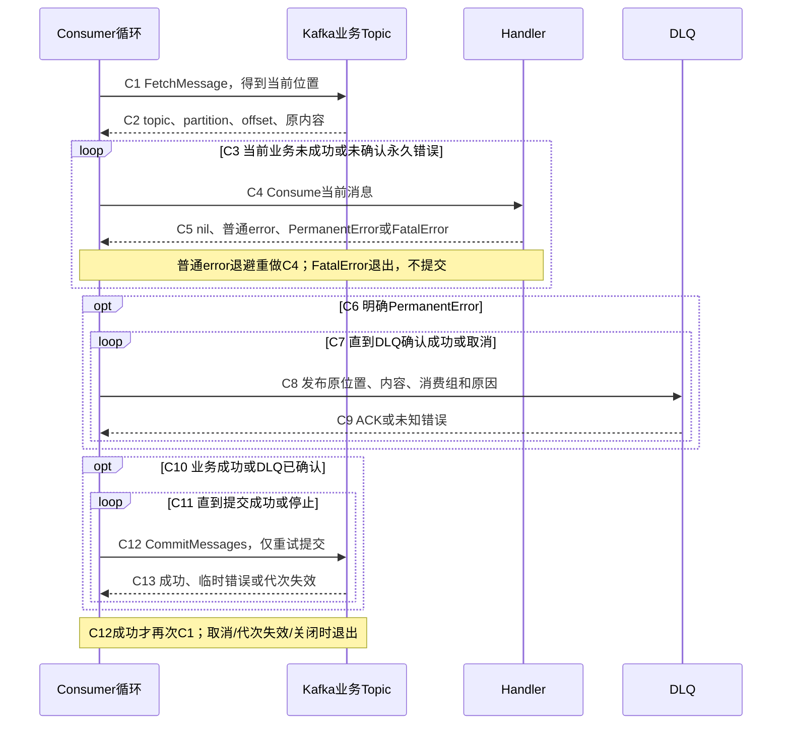

# 04 故障与并发边界

链路步骤见[架构图](01-architecture.md)和[Relay图](05-iterations-and-performance.md#e04)。每题按“已有事实、部分成功、响应、重试身份、恢复依据”回答。没有确认结果时，不能凭一次查询失败或查无记录断言失败。

## D01 ★ COMMIT结果未知，客户端应该怎么办？

**口述回答：** COMMIT响应丢失可能是事务没提交，也可能已经提交，所以不能直接返回stored或改ID重新发送。红包Send会按sender和clientMessageID回查，确认同内容已提交则返回原结果；消息Writer遇到普通提交错误当前直接向上报错，后续重试仍通过同一幂等键查证。数据库暂时不可读时保持可重试或未知，允许业务重放但不允许多写一份事实。

**展开：** M9与S7是不同事务的提交点，分别按消息键和红包发送键恢复。

| 步骤 | 已有MySQL事实 | 是否部分成功 | 客户端与重试键 | 恢复依据 |
|---|---|---|---|---|
| M9消息COMMIT未知 | Seq、message、已落库Outbox可能整体存在 | 事务内部无合法部分提交，但响应可能丢失 | 普通入口unavailable，沿用sender+clientMessageID；异步Writer不提交offset | message唯一键及已提交Outbox |
| S7资金COMMIT未知 | 扣款、红包、份额、流水、两条Outbox可能整体存在 | 资金事务整体提交或回滚，消息模块可能尚未完成 | 回查确认才成功，未确认为unknown，沿用sender+clientMessageID | red_packet唯一键及相关资金/Outbox行 |

**追问：** Redis查不到是不是失败？不是；Redis投影延迟或过期都可能查不到，必须查持久事实。

**代码与证据：** [SendService错误回查](../service/redpacket/application/send_service.go)、[Writer.Persist](../service/message/persistence/writer.go)、[普通入口错误映射](../service/realtime/internal/websocket/message.go)。

**容易说错：** 不声称当前已精确注入真实网络COMMIT响应丢失；相关验收缺口见F01。

## D02 领取或退款超时，怎么避免再次加余额？

**口述回答：** 领取响应未知时用同一红包和用户查领取记录，成功后重复请求返回原份额和金额，不再加款。退款再次扫描时锁红包并重查ACTIVE，已经EXPIRED就不再退；退款流水还有业务唯一约束。事务错误后的确认需要查状态和原业务记录，不能用Redis候选池判断是否入账。相关余额变化与流水都在原资金事务中。

**展开：** R10确认领取唯一记录；E5确认红包状态和唯一退款流水，缓存结果不参与资金成功判断。

| 步骤 | 已有MySQL事实 | 是否部分成功 | 客户端与重试键 | 恢复依据 |
|---|---|---|---|---|
| R10领取提交未知 | 份额占用、领取、加款、流水、统计可能整体存在 | 客户端可能没收到，但数据库已成功 | 领取返回unknown或原结果，重试packetID+userID | red_packet_receive唯一记录 |
| E5退款提交未知 | 退回余额、唯一流水、EXPIRED可能整体存在 | 资金内部无合法部分成功，Redis清理可能没完成 | 后台记录错误或确认结果，再处理同packetID | red_packet状态及发送者退款业务流水 |

**追问：** 同用户两个请求都查不到？事务内红包锁后复查，最终唯一键兜底；见B10。

**代码与证据：** [Receive错误回查](../service/redpacket/application/receive_service.go)、[ExpireOne](../service/redpacket/application/expire_service.go)、[退款业务唯一键](../sql/balance_log.sql)。

**容易说错：** 不说没有成功HTTP响应就没有入账；初轮负载测试确实发现过已入账但未成功响应。

## D03 ★ 业务、DLQ或offset提交失败，Consumer分别重试什么？

**口述回答：** 普通业务错误重试当前消息；确认永久错误后只重试DLQ发布，收到ACK才允许提交原offset；业务或DLQ成功以后，只重试offset提交，不在当前进程重跑业务。若进程退出后重新读取，仍可能重复业务或DLQ。消费组代次失效则停止旧Reader，避免旧身份继续提交。次数阈值只告警，不能作为跳过依据。

**展开：** 三个重试阶段由公共循环串行编排，各消费组持有自己的Reader。

图中的C3在nil时结束，在PermanentError时进入C7；FatalError结束整个消费循环，不再进入后续分支。

| 步骤 | 已有MySQL事实 | 是否部分成功 | 客户端/重试身份 | 恢复依据 |
|---|---|---|---|---|
| C4 Writer返回未知 | 红包资金可能已存在，消息也可能已提交 | 对入口而言可能未知；Cache/Push还可能已有部分投影 | 原消息命令ID不变，不提交更高offset | 原Kafka记录与message幂等键 |
| C8 DLQ未知 | 原资金或消息事实不撤销 | DLQ可能已有副本 | 无新成功响应，原group+topic+partition+offset识别重复 | DLQ ACK与原offset |
| C12提交失败 | 业务或DLQ已成功 | offset可能已提交但响应未知 | 当前只重试提交；恢复可能重放原业务 | 消费组位置与业务幂等 |

**追问：** Fatal会怎样？当前任一Realtime消费者报不可继续错误可能让整个Realtime退出，依赖重启，不是只隔离一个handler。

**代码与证据：** [RunKafkaConsumer](../service/realtime/internal/consumer/kafka_reader.go)、[Reader封装](../common/kafkareader/reader.go)、[循环测试](../service/realtime/internal/consumer/kafka_reader_test.go)。

**容易说错：** 不说自动重试达到阈值就可以自动进入DLQ；普通数据库故障不能因次数变永久错误。

## D04 Redis不可用时，项目所有功能还能工作吗？

**口述回答：** 对消息内容、发送结果和红包候选池这些业务投影，设计允许缺失或读取失败后回MySQL。但整个Redis服务宕机还影响登录状态鉴权和User RPC缓存，所以新请求可能在进入业务前就被拒绝或报不可用。实测确认这种情况下不产生新资金事实，恢复后原幂等键重试成功。不能笼统宣传Redis宕机只影响速度。

**展开：** 要先判断故障发生在业务缓存读取，还是更早的身份与权限依赖。

| 步骤 | 已有MySQL事实 | 是否部分成功 | 客户端与键 | 恢复依据 |
|---|---|---|---|---|
| M4/S2/R4缓存故障 | 已提交事实不消失 | 缓存可能只有部分Key | 可完成鉴权时回源，沿用原发送键或packet+user | MySQL消息/红包/份额 |
| M2/S2/R3登录或权限依赖Redis故障 | 本次新业务写入尚未开始 | 先前请求仍可能已经存在 | 明确身份失败或不可用，不能伪造允许 | Redis恢复后重新校验，MySQL确认旧请求 |

**追问：** 重启Redis后PING成功就够吗？真实验收遇到旧连接错误，还需要业务连接恢复及安全重试。

**代码与证据：** [Authenticator](../common/auth/authenticator.go)、[验收Redis边界](../acceptance-report.md)、[缓存路径](02-design-decisions.md#b04)。

**容易说错：** 不把“缓存Key删除验收”扩大成“所有Redis依赖宕机全可用”。

## D05 红包扣款成功但创建命令进DLQ，算完成了吗？

**口述回答：** 资金创建已经完成，但聊天消息可能没有补齐，DLQ是可定位的待修复记录。它只允许消费循环隔离确认无法原样重试的事件，不代表业务所有后续任务完成。当前实现了可靠写DLQ再提交offset，尚未建设人工重放工具；未来修复后应对失败消费组定向重放，保留原业务ID并再次做幂等查证。

**展开：** S12失败不能撤销S7的资金事实，C8只持久化待修复记录。

| 步骤 | 已有MySQL事实 | 是否部分成功 | 客户端与键 | 恢复依据 |
|---|---|---|---|---|
| S12非法命令或持久冲突，随后C8 | S7资金已提交，message可能缺失或已存在另一事实 | 跨模块可只完成资金 | 发送者资金结果不改，查询我发出的红包；不新扣款 | DLQ原位置/事件ID、红包ID、原messageID和发送键 |

**追问：** 自动退钱可以吗？不是当前规则；误退可能与后续领取竞争，必须另设计补偿业务，而非把消息错误直接当资金失败。

**代码与证据：** [Writer错误分类](../service/realtime/internal/consumer/message_writer_consumer.go)、[DLQ记录](../service/realtime/internal/consumer/dlq.go)、[我发出的红包](../service/redpacket/application/query_service.go)。

**容易说错：** 不说进DLQ就已实现完整修复闭环，也不声称所有合法请求一定已经自动补齐。

## D06 INSERT遇到1062为什么要回滚再回查？

**口述回答：** 唯一冲突可能是并发同一请求，也可能是messageID、Seq或红包关联等别的约束冲突。我先回滚原事务，让新分配Seq等修改一起撤销，再用新事务按sender和clientMessageID回查。存在且内容一致才幂等成功，不同则冲突；按原键找不到则报唯一约束不变量故障。不能用INSERT IGNORE把所有撞键静默处理成成功。

**展开：** M7报错后的回查结果决定分类，不能仅凭1062错误号返回原请求成功。

| 步骤 | 已有MySQL事实 | 是否部分成功 | 客户端与键 | 恢复依据 |
|---|---|---|---|---|
| M7唯一冲突 | 原事务回滚，可能已有另一请求提交的message | 原事务无部分提交；并发事实可能存在 | 同内容原结果、不同内容rejected；查证失败可重试；异常键停止Consumer | 新事务查message的sender+clientMessageID |

**追问：** 领取已经锁主表，还会1062吗？正常同用户竞争通常被锁内复查拦住，但ID碰撞、异常写入或未来绕开锁协议仍可能撞数据库唯一键；MySQL驱动返回错误，业务无需自己制造1062。

**代码与证据：** [Writer.reloadPersisted](../service/message/persistence/writer.go)、[Receive重复错误处理](../service/redpacket/application/receive_service.go)、[message多个唯一键](../sql/message.sql)。

**容易说错：** 当前回查根据结果判断，不解析到底哪个索引报1062；查无记录也不证明具体索引身份。

## D07 Redis弹出shareID后服务崩溃，份额会丢吗？

**口述回答：** Redis候选列表会少一项，但MySQL份额仍未领取，余额没有变化，资金不会因为这个缓存丢候选而丢失。后续Redis空池或候选陈旧时从MySQL选份额，成功降级后尝试重建；Worker也会比较剩余份额数和列表长度。两个用户拿到同一个候选时，最终份额状态和资金事务只允许一个领取成功。

**展开：** R4之后的缓存变化与R10之后的资金事实需要分开观察。

| 步骤 | 已有MySQL事实 | 是否部分成功 | 客户端与键 | 恢复依据 |
|---|---|---|---|---|
| R4成功后、R10前崩溃 | 未提交领取回滚，份额仍可领 | Redis候选可能已移除，资金未成功 | 响应丢失/unknown，原packet+user重试 | UNCLAIMED份额、领取唯一记录、后台修复 |

**追问：** 是否需要把ID立刻塞回去？不是正确性必需；未知提交时盲目回放缓存还可能陈旧，数据库兜底即可。

**代码与证据：** [CandidatePool](../service/redpacket/application/candidate_pool.go)、[usedFallback](../service/redpacket/application/receive_service.go)、[Worker修复](../service/redpacket/worker/worker.go)。

**容易说错：** 不把Redis列表变空当红包一定领完，也不说数量修复能检查所有陈旧内容。

## D08 最后一份领取与到期退款同时发生，谁赢？

**口述回答：** 两者先锁同一红包主表，数据库决定顺序。领取先完成并提交时，退款之后看到新的已领金额，领完则不退款；退款先提交EXPIRED时，领取看到过期就拒绝。领取拿锁时还未到期、执行到最后已经到期，也会由最终条件更新拒绝并整体回滚。每次判断以锁后状态和数据库时间为依据。

**展开：** R9的到期条件和E3的锁后复查分别覆盖时间变化与退款竞争。

| 步骤 | 已有MySQL事实 | 是否部分成功 | 客户端与键 | 恢复依据 |
|---|---|---|---|---|
| R9到期条件不匹配 | R8仍是未提交修改 | 回滚后没有领取、加款或份额占用 | ErrReceiveExpired，原packet+user可查既有结果 | red_packet状态与之后E1扫描 |
| E3等待领取释放锁 | 已提交领取可能已增加统计 | 没有双重支出，后来的事务按新状态计算 | 后台同packetID重试 | total-received及唯一退款流水 |

**追问：** 已完成还能领吗？新用户拒绝，同用户已有成功记录可以返回原结果；这两个分支不矛盾。

**代码与证据：** [Receive](../service/redpacket/application/receive_service.go)、[ExpireOne](../service/redpacket/application/expire_service.go)、[领取中途过期验收](../acceptance-report.md)。

**容易说错：** 不说锁定红包就冻结了时钟，也不承诺两个不同数据库里的退款与领取由同一行锁协调。

## D09 同步期间有新消息落库或推送丢失，需要给消息表加锁吗？

**口述回答：** 当前不为了交接而锁消息表，而是把同步进度和实时展示分开。同步读取本次最大已提交Seq并返回区间游标，实时只合并不推进同步游标。查询水位之后新提交的消息留给下一轮；推送没收到也由重连、打开会话和定时同步补齐。只有成功合并并保存同步结果后才能推进游标，避免直接跳到最大实时Seq漏中间消息。

**展开：** W5是实时展示，W8才推进同步进度，两者不能合用最大Seq。

| 步骤 | 已有MySQL事实 | 是否部分成功 | 客户端与键 | 恢复依据 |
|---|---|---|---|---|
| W5推送丢失 | 新消息已经在message表 | 实时展示缺失，不影响事实 | 无副作用，继续原session+afterSeq | 下一轮水位与区间查询 |
| W7响应丢失或W8保存失败 | 本次区间仍在MySQL | 本地可能部分合并，游标应未推进 | 原游标重拉，messageID去重 | 独立syncCursor与服务端消息 |

**追问：** hasMore=false就彻底追平吗？仅追平这次水位；持续写入下靠后续触发。当前单次任务还有50页上限，后续触发继续推进。

**代码与证据：** [Reader.Sync](../service/offline/internal/syncer/reader.go)、[performSyncConversation](../../webark-im-template/src/imlearn/dataSource.ts)、[浏览器交接验收](../acceptance-report.md)。

**容易说错：** 不宣称localStorage已是完整原子本地数据库；当前仅保存最近500条，完整历史浏览需另设计。

## D10 Relay租约过期、ACK丢失或回写失败，会不会漏发？

**口述回答：** 领取已提交后事件保存在PROCESSING，发布前检查租约，回写SQL还检查owner、status和数据库时间。ACK未知不能标记成功；已ACK但回写未知也可能重放。当前批量确认只包含已ACK前缀，异常停止后续，未确认的有效自有租约尝试释放，失败或进程消失等待租约到期。接受重复，不能把未确认事件当已发布跳过。

**展开：** B3确认领取、B6确认发布、B9确认状态、B12释放租约，分别分析结果未知的边界。

| 步骤 | 已有MySQL事实 | 是否部分成功 | 客户端与重试身份 | 恢复依据 |
|---|---|---|---|---|
| B3领取COMMIT未知 | 业务Outbox已存在，租约可能存在 | 未发布新消息，不确定是否领到 | 业务成功不撤销；原eventID不变 | PENDING或过期PROCESSING |
| B6发布ACK未知 | 事件已存在，Kafka也可能已有副本 | 外部发布可能成功 | 保留原eventID/messageID，停止后续并重排 | next_retry_at或租约恢复 |
| B9确认未知/租约失效 | Kafka已ACK，确认事务可能提交 | 当前确认块可能重放 | 不返回新业务拒绝，下游幂等 | PUBLISHED不重发，其余释放/过期恢复 |
| B12释放失败/进程消失 | 尚未确认行仍存在 | 已ACK未回写与未发行都可能留下 | 不删记录，身份不改 | lease_until到期重新领取 |

**追问：** 两个Relay接管还能严格顺序吗？当前没有续租和fencing，旧调用可能在租约过期后完成Kafka发送，不能承诺多活接管严格顺序，见F03。

**代码与证据：** [Worker](../service/outboxrelay/internal/relay/worker.go)、[Store](../service/outboxrelay/internal/relay/store.go)、[真实MySQL测试](../service/outboxrelay/internal/relay/store_integration_test.go)、[批量报告](../relay-batch-report.md)。

**容易说错：** 不说120秒租约彻底消除了重复；下游幂等也不能自动解决多发布者顺序。
