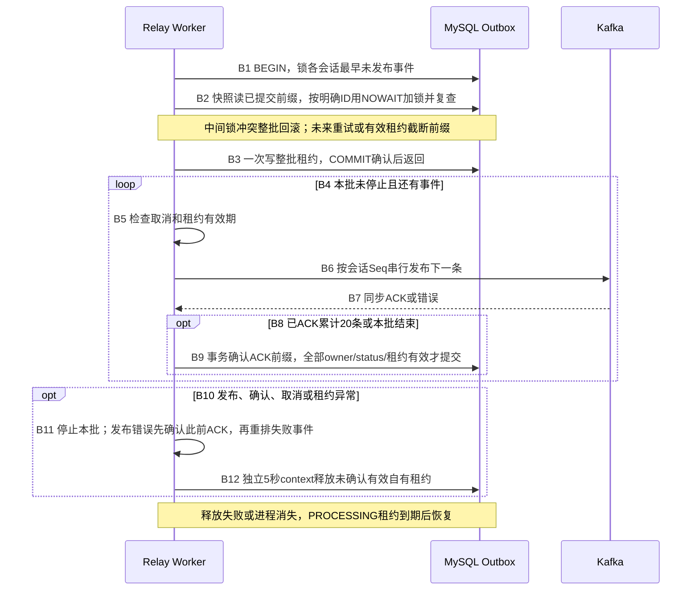

# 05 设计迭代与性能优化

先讲问题和测量，再讲修改，最后讲结果及限制。下面均为本项目记录，不能把本机负载结果写成生产容量。

## E01 ★ 项目是怎样迭代成当前架构的？

**口述回答：** 本项目早期消息经过Accepted、Transfer签发Seq、Sequenced，再并行落库和推送。我在学习与复盘中重点确认了先推后落、跨系统双写和失败offset被后继越过的风险，随后采用统一Writer，在MySQL事务里签发Seq、落消息和写Outbox。红包也把资金操作收进同步数据库事务，Redis只给候选。之后简化通知为查询刷新，补同步游标交接，再通过真实验收和压测优化连接池与Relay。

**展开：**

| 阶段 | 问题/目标 | 当前选择 | 代价 |
|---|---|---|---|
| 旧消息链路复盘 | Seq、落库、推送分离，失败边界复杂 | 统一Writer，Seq+message+Outbox同事务 | 会话行锁串行点 |
| 红包设计 | Redis到Kafka窗口，资金异步结果难确认 | 发送/领取/退款同步MySQL事务 | 热门红包行锁 |
| 消费策略 | 失败offset可能被高offset越过 | 当前消息完成后显式同步提交 | Reader串行阻塞 |
| 产品简化 | 生命周期通知增加链路 | 详情查询和主动刷新 | 短暂展示延迟 |
| 同步交接 | 实时高Seq不能代表中间已同步 | 独立syncCursor | 去重与后续同步 |
| 性能迭代 | 连接耗尽、Relay积压 | 连接预算、连续循环、索引、批量前缀与确认 | 资源额度、重复窗口、单Relay限制 |

**追问：** 这些全部是你手写的吗？如实按F06回答：老师项目参考、开发者业务取舍与走读、AI协助实现和验证。

**代码与证据：** [D1～D33](../redpacket-design.md)、[验收报告](../acceptance-report.md)、[各轮负载报告](../load-test-report.md)。

**容易说错：** 不把历史方案和当前方案混着讲，也不根据本项目决议推断老师原项目所有部署状态。

## E02 为什么把消费者从旧封装改成kafka-go Reader？

**口述回答：** 调整的原因是消费推进语义。旧处理方式在当前项目配置下，失败消息虽不提交，后续成功消息仍可能提交更高offset，造成越过。改为显式Fetch、处理和同步Commit后，我能清楚控制当前消息完成前不前进；再补临时重试、永久错误DLQ和提交阶段单独重试。串行实现简单，未来并行要额外维护每分区连续完成位置。

**展开：** 后续真实Kafka停机验收又发现EOF不能直接等价为主动Close，于是加Reader封装记录主动关闭状态，网络EOF交原重试处理，消费组代次失效仍停止。

**追问：** 这是说所有kq项目都不可靠吗？不是；判断针对本项目旧消费循环和提交策略，不能脱离版本、配置与调用路径泛化。

**代码与证据：** [当前循环](../service/realtime/internal/consumer/kafka_reader.go)、[Reader封装](../common/kafkareader/reader.go)、[EOF验收记录](../acceptance-report.md)、设计D17。

**容易说错：** 不说换库自动解决幂等和双写，核心仍是处理与提交顺序。

## E03 压测为什么先优化连接池？怎么分配额度？

**口述回答：** 初轮实际触发本机MySQL的151连接上限，说明多个服务的连接需求必须合计，不能每个服务单独放大。现在7个使用MySQL的进程显式配置连接池，示例最大数合计96，并在创建Model之前应用配置。连接额度不足时请求排队或超时，额度也不能无限扩大，因为热门红包和会话行锁仍串行，更多连接可能只增加等待。

**展开：** RPC16、User API8、Offline16、Realtime24、红包API24、红包Worker4、Relay4，合计96；网关没有MySQL池。缺省配置各16，扩容时必须按实例数重新计算，并给运维/其他连接预留。

**追问：** 96是否固定最优？不是，是本机验证过的配置，随数据库能力、实例数和负载重新评估。

**代码与证据：** [mysqlpool](../common/mysqlpool/pool.go)、[连接预算报告](../load-optimization-report.md)、各服务example配置。

**容易说错：** 不把所有进程合计96说成每进程96；池等待超时也不必然是某条SQL执行本身慢。

## E04 ★ 原来已经批量领取，为什么还要改Relay？

**口述回答：** 原来总批量最多100，但同一会话每批只能取最早一条。600条都在一个热门会话时，要反复做领取和逐条状态回写。现在允许领取该会话已提交的有序前缀，示例上限500，一次写整批租约；Kafka仍逐条等待ACK，每20条或批尾原子确认已ACK前缀。异常不继续发布后继，未确认任务释放或等待租约恢复，以增加重复窗口换减少数据库事务次数。

**展开：** 500是领取上限，不等待凑满；20是数据库确认批次，不是Kafka并行批发。实际积压少时领取少，批尾马上确认。一次发布失败停止整批，包括其他会话后续，接受暂时调度影响。

**追问：** 怎么证明不是跳过中间Seq换来快？真实MySQL测试检查首条被锁、中间冲突回滚、退避和租约屏障；另预置600条确认首批500、确认后尾部100从501开始。B3/B6/B9/B12故障见D10。

**代码与证据：** [Store](../service/outboxrelay/internal/relay/store.go)、[Worker](../service/outboxrelay/internal/relay/worker.go)、[数据库测试](../service/outboxrelay/internal/relay/store_integration_test.go)、[批量报告](../relay-batch-report.md)。

**容易说错：** 不说同会话500条并行发送，也不承诺宕机时当前未确认块不会重复。

## E05 还有哪些Relay优化？怎么证明索引起作用？

**口述回答：** 首先修正同步单条WriteMessages却等待Kafka默认攒批的问题，将Writer BatchSize设1。其次Relay成功且有任务时立即下一轮，空批或错误才等待200ms。随后增加分段计时，在旧负载数据副本做实际领取SQL执行计划对照，确认前序检查扫描历史已发布记录的成本，新增status在Seq前的覆盖索引。最后才做同会话前缀和批量确认。

**展开：** 索引阶段两轮采用相同固定600条消息方法，热门会话100并发推送P95约47.5秒降到9.6秒；这项对照只改变索引。不能用混合改动的最终4.1秒全归功于索引。

**追问：** 为什么不用更短ticker？有积压时现在已经连续处理，缩短空闲轮询并不能替代减少领取和回写开销。

**代码与证据：** [Publisher](../service/outboxrelay/internal/mq/publisher.go)、[连续循环](../service/outboxrelay/internal/relay/loop.go)、[索引迁移](../sql/migrations/20261006_outbox_relay_predecessor_index.sql)、[索引报告](../relay-performance-report.md)。

**容易说错：** Publisher BatchSize=1和Relay BatchSize=500是两层不同参数。

## E06 优化过程中有没有失败？怎么处理？

**口述回答：** 有，第一轮批量负载发现WebSocket心跳读取被同步业务阻塞，两条连接超时，压测还重复使用关闭连接产生大量错误；我保留失败记录，修复读循环与业务循环分离，并让压测停止复用关闭连接。下一轮请求通过但出现82次Relay领取锁冲突，定位到范围锁碰上Writer未提交尾部，改为先快照列出已提交ID再按ID加锁，保留中间冲突必须回滚的规则。

**展开：** WebSocket修复有实际WS测试，慢业务期间Ping仍能得到Pong，后续业务顺序保持。MySQL测试在其他事务持有未提交尾部时仍领取已提交前缀；最终轮没有Relay领取错误，但有1次消息写入超时。

**追问：** 修压测是否掩盖错误？没有把服务错误转成成功，失败轮和中间轮均保留；停止关闭连接的worker只是避免瞬时无效请求耗尽预算。

**代码与证据：** [初轮记录](../scripts/relay-batch-initial-results-20261006.json)、[中间冲突记录](../scripts/relay-batch-contention-results-20261006.json)、[WS测试](../service/realtime/internal/websocket/client_test.go)、[最终报告](../relay-batch-report.md)。

**容易说错：** 不只挑PASS轮汇报；最终代码对应的轮次必须单独说明。

## E07 性能改善有多少？压测口径是什么？

**口述回答：** 本机Docker依赖与单Realtime、单Relay环境，用10、50、100并发分别发送固定600条到一个会话和20个会话，阶段间等传播排空。延迟从客户端开始发送算到stored ACK或观察连接首次收到。批量优化对照中，100并发热门会话成功消息推送P95约9.6秒降到4.1秒，多会话约9.8秒降到3.7秒；最终有1次写入超时，所以不能说容量全部通过。

| 场景 | 之前推送P95 | 最终推送P95 | 最终成功/尝试 |
|---|---:|---:|---:|
| 单会话10并发 | 7.32s | 0.32s | 600/600 |
| 20会话10并发 | 6.01s | 0.66s | 600/600 |
| 单会话50并发 | 7.46s | 2.15s | 600/600 |
| 20会话50并发 | 7.55s | 3.88s | 600/600 |
| 单会话100并发 | 9.63s | 4.12s | 599/600 |
| 20会话100并发 | 9.81s | 3.73s | 600/600 |

**展开：** 最终13组15,960次请求有1次错误；20条低负载观察另计，推送P95为232ms。成功百分位不包含那次失败，100并发热门阶段错误率为1/600约0.17%，不能用全套请求数稀释该场景问题。固定600次负载不是长时间稳定压测，机器参数和日志采样见原始环境记录。

**追问：** 能写简历吗？可以写“本机固定消息数对照中成功消息推送P95降低”，同时能说明条件与剩余超时；不写生产QPS或100并发稳定无错误。

**代码与证据：** [负载驱动](../scripts/project-load-test.mjs)、[运行环境脚本](../scripts/project-load-test.ps1)、[最终原始数据](../scripts/relay-batch-results-20261006.json)、[分段数据](../scripts/relay-batch-timings-results-20261006.json)。

**容易说错：** 推送P95包含权限与写入排队，不是纯Relay或网络延迟；批量阶段同时有多个改动。

## E08 4.1秒是不是还慢？如果继续优化从哪入手？

**口述回答：** 高并发热门会话下4.1秒仍有明显延迟，且有1次请求超时。本轮同场景stored ACK P95约4.08秒，说明写入之前及写入阶段已占有很大等待，继续扩大Relay批次可能收益有限。下一步应给权限RPC、连接池等待、幂等查证、会话锁和提交分别计时，再决定减少持锁时间或做写入排队控制，不通过无限增加连接或放宽超时解释结果。

**展开：** 两个总体P95不能直接相减当作同一请求的Relay耗时。当前失败日志定位为幂等查询context deadline exceeded，该原键事后查无消息；连接池排队和热点锁等待只是候选原因，还没有逐请求测量确定唯一根因。

**追问：** 分库分表能解决同会话热点吗？能分散不同会话负载，但同一会话严格排序仍需串行点。并行Consumer也要先设计连续offset提交。

**代码与证据：** [写入期限](../service/realtime/internal/websocket/message.go)、[Sequence锁](../service/message/model/conversation_sequence/model.go)、[剩余超时记录](../relay-batch-report.md)。

**容易说错：** 不说热点问题已经彻底解决，也不将推断直接写成实测根因。
