# IM-learn 红包模块设计决策与故障边界

> 文档用途：交接给后续 Codex 或开发者，作为红包模块设计与实现依据。  
> 当前状态：消息主链、红包发送、领取、过期退款、CacheBuild Consumer、候选池修复和查询接口均已编码；红包生命周期通知链路已移除，详情接口改为读取领取记录。真实 MySQL/Redis/Kafka 联调和并发故障验收仍待完成。
> 本阶段范围：红包发送、领取、过期退款、消息推送、Redis 缓存和可靠事件传播。  
> 当前计划：对资金事务、候选池、消息 Relay 重投与离线同步做跨服务故障验收；Kafka DLQ 已接线，不建设通用失败管理平台。网关已加入静态统一入口，后续扩展另行决策。
> 2026-09-23 用户更新迁移决策：立即移除旧版 Accepted/Transfer/Sequenced/Offline Store 运行链路，代码只保留 Outbox 路径。第 20 节 D16 和第 21 节关于保留 legacy 的内容属于当时的历史决议，不再适用；资金与消息一致性原则不变。

## 1. 项目背景与既有能力

当前项目已经具备：

- WebSocket Realtime 服务；
- 单聊、群聊及群成员权限校验；
- 旧版 `accepted → transfer → sequenced → store/push` Kafka 消息链路；
- 旧版 Redis 号段式会话 Seq 分配；
- 消息 MySQL 落库；
- Redis 热消息缓存与 MySQL 冷数据回源；
- 在线实时推送与离线消息同步；
- `MessageTypeRedPacket = 3`；
- 用户余额表、余额流水表的初步结构。

当前学习项目位于：

```text
D:\C题2025\IM\IM-learn
```

旧版消息链路仍存在于当前代码中，但属于待迁移实现，不能再作为红包模块的目标架构。红包模块可以借鉴 Redis Lua 抢占、随机金额预分配、Kafka 异步事件和过期 ZSET，但资金与消息一致性以本文最终方案为准。

## 2. 已确定的最高原则

### 2.1 MySQL 是事实源

严格区分两类事实：

- `message` 表决定红包聊天消息是否存在；
- `red_packet`、`red_packet_share`、`red_packet_receive`、`user_balance`、`balance_log` 决定资金归属。

资金类事实必须在同一个 MySQL 本地事务中提交（当前相关表位于同一个 MySQL 数据库，因此使用本地事务，不引入分布式事务）。红包资金事实与聊天消息事实不处于同一个事务：红包事务提交消息创建 Outbox，由消息模块在自己的事务中签发 Seq、写入 `message` 和消息推送 Outbox，二者最终一致（见 2.6）。

### 2.2 Redis 永远不是最终事实

Redis 可以随时宕机、过期、被清空或保存陈旧数据。系统必须满足：

```text
FLUSHALL Redis
→ 不丢红包
→ 不丢领取记录
→ 不多钱、不少钱
→ 可以仅凭MySQL重建缓存
```

Redis 只承担：

- 发红包请求幂等结果的热缓存；
- 已经落库的消息发送幂等结果缓存，即 `senderID + clientMessageID → messageID + seq + fingerprint`；
- 未领取红包份额 ID 的候选池；
- 已经落库的聊天消息短期热缓存，供离线增量同步优先读取；
- 快速过滤和降低 MySQL 查询压力；
- 可删除、可重建的投影数据。

### 2.3 Kafka 只传播已提交的事实或意图

Kafka 不负责决定钱是否到账，也不作为消息落库事实。资金结果、消息创建意图或已落库消息事件必须先与对应业务数据一起提交到 MySQL，再由 Outbox Relay 发布。

语义为：

```text
Outbox：至少发布一次
Kafka：可能重复投递
Consumer：幂等或可重建
最终业务：只生效一次
```

### 2.4 WebSocket 不是可靠落点

Realtime Push Consumer 只消费 `ChatMessagePersistedEvent`。WebSocket 写成功不代表客户端一定完成处理；红包消息最终由 MySQL `message` 表和离线同步兜底，客户端按 `messageID` 去重。

### 2.5 正确性优先于可用性

基础设施状态不确定时，不能继续执行资金操作。例如权限 RPC 不可用时，应在扣款前返回可重试错误。红包发送不再依赖事务外 Seq 分配器；Seq 由消息模块在后续消息事务内签发。

### 2.6 红包消息进入统一消息写入链路（2026-09-21 最终决议）

红包 API 不直接写 `message` 表。红包事务只写资金事实和 `ChatMessageCreateRequestedEvent` Outbox；Outbox Relay 将事件投递到 `message-create-requested-topic`，Message Writer Consumer 再调用统一的 `MessageWriteService`。

`MessageWriteService` 是 `message` 表的唯一逻辑写入者，两个入口共用同一套事务逻辑：

1. 普通消息由 Realtime 校验后同步调用 `MessageWriteService`；
2. 红包消息由 Message Writer Consumer 消费 `ChatMessageCreateRequestedEvent` 后调用同一个 `MessageWriteService`。

两种入口的 `messageID` 所有权不同：普通消息不允许客户端指定服务端 `messageID`，由 `MessageWriteService` 在持久化幂等确认不存在后生成；红包消息的 `messageID` 由 RedPacket API 在红包事务前生成，写入 `red_packet` 和消息创建 Outbox，Message Writer 必须复用该 ID，不能再次生成。

每次新消息写入都在一个 MySQL 本地事务内完成：

```text
锁定 conversation_sequence 的 sessionID 行
→ 签发并更新 next Seq
→ 插入 message
→ 插入 ChatMessagePersistedEvent Outbox
→ COMMIT
```

Outbox Relay 随后把 `ChatMessagePersistedEvent` 发布到 `message-persisted-topic`，Realtime Push Consumer 只推送已经落库的消息。旧版 `ChatMessageAcceptedEvent`、Transfer Consumer 和 `ChatMessageSequencedEvent` 不再属于目标架构。

代价：红包消息可能晚于扣款出现（毫秒到秒级）；若 Relay 或 Message Writer 暂时不可用，会出现「已扣款但聊天里暂时看不到红包」。收口方式是两段 Outbox 重试、Message Writer 幂等、告警，以及发送者可查询「我发出的红包」。

## 3. 必须维持的业务不变量

1. 发红包成功后，扣款、红包、份额、扣款流水和 `MESSAGE_CREATE_REQUESTED` Outbox 必须同时存在；消息由 Message Writer 最终补齐。
2. 发红包失败时，上述资金类数据必须同时不存在。
3. 同一个发红包请求无论重试多少次只能扣款一次。
4. 同一个用户对同一个红包最多领取一次。
5. 同一份 `shareID` 最多属于一个用户。
6. 领取记录、份额归属、余额增加、领取流水和红包统计必须一起提交或一起回滚。
7. 过期退款、余额增加、退款流水和红包状态必须一起提交或一起回滚。
8. Redis 中任何数据都必须可以由 MySQL 推导。
9. Kafka 重复事件不能导致重复资金变化。
10. HTTP 响应丢失后，客户端使用原幂等键必须得到原结果。
11. `message` 表只能由 `MessageWriteService` 写入；红包模块不得直接插入消息。
12. 新消息的 Seq 更新、`message` 插入和 `ChatMessagePersistedEvent` Outbox 必须一起提交或一起回滚。
13. Realtime Push Consumer 只能消费已落库事件，不能消费“待创建”或“已分配 Seq”事件。

## 4. ID 与幂等键决策

| 字段 | 作用 | 生成者 | 幂等范围 |
|---|---|---|---|
| `clientMessageID` | 一次红包消息发送意图，同时作为发红包请求幂等键 | 客户端 | `senderID + clientMessageID` |
| `redPacketID` | 红包业务聚合 ID | 服务端 | 全局唯一 |
| `messageID` | 聊天消息 ID；普通消息由 MessageWriteService 生成，红包消息由 RedPacket API 预生成并由 Message Writer 复用 | 对应业务的服务端写入者 | 全局唯一 |
| `shareID` | 一份红包金额 ID | 服务端 | 全局唯一 |
| `eventID` | Outbox/Kafka 事件 ID | 服务端 | 每个 Consumer Group 内幂等 |
| `receiveID` | 领取记录 ID | 服务端 | 全局唯一 |

Snowflake `int64` ID 输出到 JSON 时必须使用字符串，避免 JavaScript 精度损失。

`messageID` 生成规则：

- 普通消息命令不携带可用的服务端 `messageID`；`MessageWriteService` 先查 `senderID + clientMessageID` 的 Redis 幂等结果缓存，未命中或 Redis 不可用时再进入 MySQL 持久化幂等检查，确认消息不存在后调用自己的 Snowflake Generator 生成；
- 红包消息创建命令必须携带 RedPacket API 已生成的 `messageID`；该 ID 已经是红包事务的一部分，Message Writer 只校验和复用；
- 如果普通消息事务明确回滚，已生成但未落库的 Snowflake ID 可以废弃；如果 COMMIT 结果未知，重试必须先按 `senderID + clientMessageID` 查询，存在则返回原 `messageID`，不能盲目生成并插入第二条消息；
- 客户端永远不能直接指定服务端 `messageID`。

消息发送幂等缓存使用新版本 Key，例如 `im:message:idempotency:v3:{senderID}:{clientMessageID}`。它与旧版 Realtime `SETNX` 身份预占不同：新版缓存只保存已经落库的结果，Redis 未命中绝不代表消息不存在，最终仍由 MySQL 唯一约束和持久化查询裁决。

## 5. 金额与安全决策

- 所有金额使用 `int64`，单位为“分”。
- API 不接受浮点金额；如果前端提交元字符串，必须进行严格十进制定点解析，不能使用 `float64`。
- `senderID`、`receiverID/userID` 必须来自 JWT 或可信网关上下文，不能相信客户端请求体。
- 单聊/群聊枚举统一沿用当前项目：`0 = 单聊`，`1 = 群聊`。
- 发红包和抢红包都要进行会话权限校验；权限 RPC 超时属于“状态未知”，不能继续资金操作。单聊红包额外要求领取者等于 `receiver_id`，发送者本人不能领取；群红包按会话成员判定。

## 6. 建议数据模型

### 6.1 red_packet

至少需要：

```text
red_packet_id
message_id
sender_id
client_message_id
session_id
session_type
red_packet_type
wrapper_text
total_amount
total_count
received_amount
received_count
status
version
expire_at
created_time
updated_time
```

唯一约束：

```text
PRIMARY KEY(red_packet_id)
UNIQUE(sender_id, client_message_id)
UNIQUE(message_id)
```

### 6.2 red_packet_share

随机金额不能只存在 Redis，必须持久化每一份：

```text
share_id
red_packet_id
ordinal
amount
status            UNCLAIMED / CLAIMED
receiver_id       nullable
received_at       nullable
created_time
updated_time
```

约束：

```text
PRIMARY KEY(share_id)
UNIQUE(red_packet_id, ordinal)
```

### 6.3 red_packet_receive

```text
receive_id
red_packet_id
share_id
receiver_id
amount
received_at
```

约束：

```text
UNIQUE(red_packet_id, receiver_id)
UNIQUE(share_id)
```

### 6.4 balance_log

增加可表达业务幂等性的唯一键，逻辑上至少保证：

```text
UNIQUE(user_id, business_type, business_id)
```

示例：

```text
senderID + SEND_RED_PACKET + redPacketID
receiverID + RECEIVE_RED_PACKET + redPacketID
senderID + REFUND_RED_PACKET + redPacketID
```

### 6.5 outbox_event

Outbox 是 MySQL 普通表，记录“事务提交后必须发布的事件任务”：

```text
event_id
event_type
aggregate_type
aggregate_id
aggregate_seq      nullable；消息已落库事件填写message.seq
topic
message_key
payload
status             PENDING / PROCESSING / PUBLISHED
retry_count
next_retry_at
lease_until
lease_owner
last_error
created_time
updated_time
published_time
```

`PUBLISHED` 只表示 Kafka Broker 已确认接收，不表示下游 Consumer 已完成处理。

约束：

- `MESSAGE_CREATE_REQUESTED` 的 `aggregate_id` 使用 `redPacketID`，`message_key` 使用 `sessionID`；此时尚未签发 Seq，`aggregate_seq` 为空；
- `MESSAGE_PERSISTED` 的 `aggregate_id` 使用 `sessionID`，`aggregate_seq` 使用消息 Seq，`message_key` 使用 `sessionID`；
- 同一会话的 `MESSAGE_PERSISTED` 必须按 `aggregate_seq` 发布；Kafka Key 固定为 `sessionID`。

### 6.6 conversation_sequence

新版 Seq 不再使用 Redis 号段作为事实来源。每个会话在 MySQL 保存一条计数器记录：

```text
session_id          PRIMARY KEY
last_seq
updated_time
```

`MessageWriteService` 在消息事务内对 `session_id` 精确执行 `SELECT ... FOR UPDATE`，然后将 `last_seq + 1` 同时用于更新计数器和插入消息。不同会话锁不同的行，可以并发；同一会话为了获得严格顺序必须串行。

会话创建时应同时创建 `conversation_sequence(last_seq=0)`。迁移已有数据时按每个会话的 `MAX(message.seq)` 回填；消息事务若发现计数器行缺失，必须先以幂等方式补建，再锁行签发，不能使用未加锁的 `MAX(seq)+1`。

### 6.7 message

红包消息与普通消息共用 `message` 表，关键约束为：

```text
PRIMARY KEY(message_id)
UNIQUE(sender_id, client_message_id)
UNIQUE(session_id, seq)
UNIQUE(red_packet_id)
```

普通消息的 `red_packet_id` 为空；红包消息必须填写对应的 `redPacketID`。消息幂等冲突时，只有已存在记录与本次命令语义完全一致才能视为成功，否则属于永久冲突。

## 7. 红包状态机

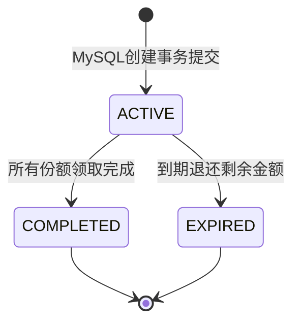

Redis 初始化不是红包进入 `ACTIVE` 的条件，因为 Redis 不是事实源。

## 8. 发红包完整数据流程

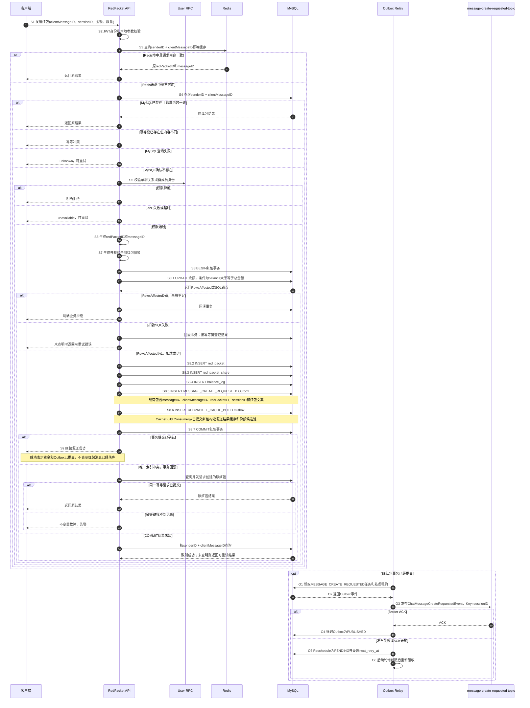

本图只描述红包资金事务以及它向消息模块输出可靠的创建命令。消息如何签发 Seq、落库和推送统一放在第 9 节；Redis 缓存预热放在第 11 节，避免在一张图中混合三个模块。

### 8.1 发红包的最终提交点

只有 `S8.7 MySQL COMMIT` 已提交且结果得到确认，才表示红包发送成功；即使 COMMIT 响应丢失，也可通过幂等键回查确认。

```text
COMMIT前：没有红包成功事实
COMMIT后：扣款、红包、份额、流水和消息创建Outbox同时存在；消息由Message Writer最终补齐
```

### 8.2 发红包主要边界

| 故障步骤 | 处理决策 |
|---|---|
| S1 请求丢失 | 客户端复用相同 `clientMessageID` 重试 |
| S3 Redis失败 | 回源 MySQL |
| S4 MySQL查询失败 | 不能继续创建，返回 unknown/retryable |
| S5 权限 RPC 超时 | 不扣款，返回可重试错误；已提交的同内容幂等请求不重新校验权限 |
| S8任意子步骤失败 | 整个事务回滚 |
| S8唯一索引冲突 | 回滚后查询并发成功请求的原红包 |
| S8 COMMIT结果未知 | 按 `senderID + clientMessageID` 查询，不能直接重新扣款 |
| S9响应丢失 | 客户端重试后返回原结果 |
| Kafka失败 | Outbox保持 PENDING 并重试 |
| Kafka成功但ACK丢失 | 重复发布；下游幂等 |
| Message Writer暂时不可用 | 红包资金事实不回滚；创建命令保留并重试 |
| 红包消息晚于扣款出现 | 允许；由消息创建Outbox最终补齐，发送者可查询「我发出的红包」 |
| WebSocket失败 | MySQL消息和离线同步兜底 |
| Redis缓存构建失败 | 抢红包降级 MySQL，后续重建 |

## 9. 消息统一落库与实时推送

普通消息和红包消息具有不同入口，但最终必须调用同一个 `MessageWriteService`。红包模块只产生消息创建命令，不拥有 `message` 表写权限。

下图用于对照既有主线实现；包含最新错误分类、Kafka DLQ、简化指纹规则及推送排除发信人的目标全流程见 §9.6。

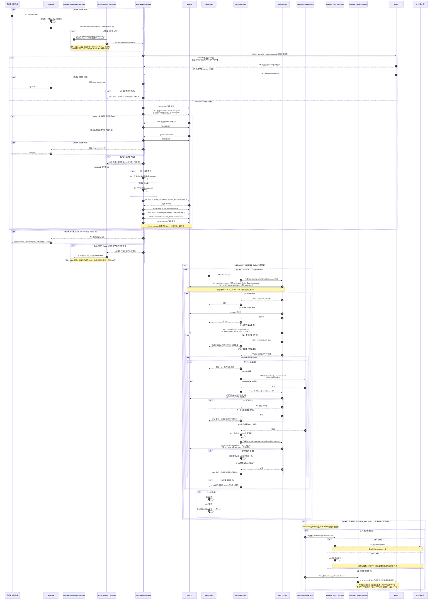

### 9.1 两段 Outbox 的职责

第一段位于红包事务：

```text
红包资金事实
+ ChatMessageCreateRequestedEvent Outbox
```

它解决“红包已经扣款，但消息创建命令丢失”的双写问题。

第二段位于消息事务：

```text
conversation_sequence更新
+ message落库
+ ChatMessagePersistedEvent Outbox
```

它解决“消息已经落库，但实时推送事件丢失”的双写问题。普通消息和红包消息都使用第二段 Outbox。

红包事务还会独立写入 `REDPACKET_CACHE_BUILD` Outbox，用于缓存预热。消息创建、消息推送和缓存构建三类任务互相独立，一个失败不能阻塞另一个。

### 9.2 Outbox Relay 与顺序

Outbox Relay 使用租约领取任务；Broker ACK 后才把记录标记为 `PUBLISHED`。ACK 未知会导致重复发布，因此所有下游都必须幂等。

`MESSAGE_PERSISTED` 还必须维持会话内顺序：

- Outbox 记录保存 `aggregate_id = sessionID` 和 `aggregate_seq = message.seq`；
- Kafka Key 使用 `sessionID`，保证同一会话进入同一 Partition；
- 初版对消息推送事件使用单个有效 Relay 发布者，并按 `aggregate_seq` 发布；
- 未来扩容时按 `hash(sessionID)` 固定分片，同一会话不能被多个 Relay 并行发布；
- `SKIP LOCKED` 只能用于领取不同会话或无顺序依赖的任务，不能让同一会话的 `seq=N+1` 越过 `seq=N`。

#### 9.2.1 Relay 轮询与领取（历史实现，2026-09-24）

以下 `L` 步骤展开第 9 节的 P1–P5。前提是业务事务已经提交 Outbox 行：普通消息和已创建的红包消息对应 `MESSAGE_PERSISTED`；红包资金事务产生的 `MESSAGE_CREATE_REQUESTED` 也由同一 Relay 轮询。图描述当前代码行为，尚未经过数据库联调。

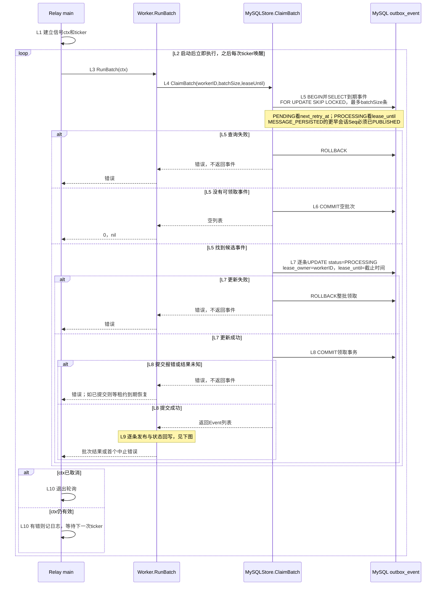

`ClaimBatch` 的 L5 只选 `(status=0 AND next_retry_at<=NOW(3))` 或 `(status=1 AND lease_until<=NOW(3))`。同会话 `MESSAGE_PERSISTED` 的更早 `aggregate_seq` 只要未发布，后续 Seq 就不应被领取；Kafka Key 使用 `sessionID`。L7 和 L8 完成后 MySQL 行锁释放，留下的 `PROCESSING` 和租约是持久状态，Kafka 发布不在领取事务内。

#### 9.2.2 单条发布、回写与失败恢复

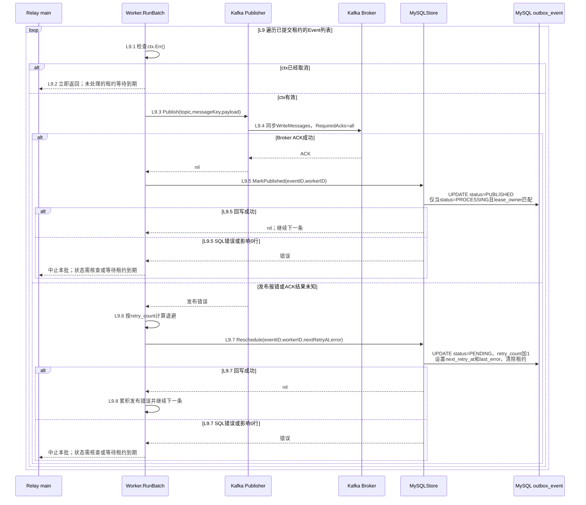

| 步骤与边界 | 当前处理与表中结果 | 后续恢复 |
|---|---|---|
| L5 尚未到 `next_retry_at`、租约未到期、前序 Seq 未发布，或行被其他事务锁住 | 本轮不领取；`SKIP LOCKED` 跳过锁住的行。同会话后续 Seq 不能因前序被跳过而抢先发布 | 等待后续 ticker；前序发布后再领取后续 Seq |
| L5 查询失败或 L7 更新失败 | 领取事务回滚，`RunBatch` 返回错误；main 在 ctx 有效时记日志 | 下一轮重新领取 |
| L8 COMMIT 报错或结果未知 | `ClaimBatch` 不向 Worker 返回事件；数据库可能已提交租约，也可能回滚 | 回滚则下一轮可领；若已提交，等 `lease_until` 到期后重新领取 |
| L5 空批次 | `RunBatch` 返回 `0,nil`，不向 Kafka 发送 | main 等下一次 ticker，不空转忙轮询 |
| L9.1 取消发生在下一条发布前 | 本批提前结束；已领取但未处理的行通常仍为 `PROCESSING` | 租约到期后可重新领取；若取消发生在发布/回写中，结果可能未知 |
| L9.3–L9.4 发布报错或 Broker ACK 未知，L9.7 成功 | 该行回到 `PENDING`，`retry_count+1`，记录 `last_error`、清空租约；本批继续处理其他事件，最后用 `errors.Join` 返回发布错误 | 到 `next_retry_at` 后再领；Broker 可能实际已接收，故消费者必须幂等 |
| L9.5 Broker 已 ACK，但标记 `PUBLISHED` 失败 | `RunBatch` 立即中止；数据库更新结果可能未知，剩余已领取事件未处理 | 核查行状态；仍为 `PROCESSING` 的行在租约到期后可能重复发布 |
| L9.7 Reschedule 失败 | `RunBatch` 立即中止；数据库更新结果可能未知，剩余已领取事件未处理 | 核查行状态；若仍为 `PROCESSING`，等待租约到期重领 |
| L9.5 回写成功 | `status=PUBLISHED`、写入 `published_time`、清除租约 | 仅表示 Broker 已接收；消费者处理及 offset 另见 §10 |

`RunBatch` 返回的数量是本轮领取的事件数，不是成功发布数；发布失败但成功 Reschedule 时会继续处理本批其他事件。`retryBackoff` 只限制最大等待时长，目前没有发布重试次数上限，也没有在 Relay 层自动进入 DLQ。

当前 `leaseUntil` 在领取整批之前计算，整批共享同一截止时间，而 Worker 串行发布且没有续租。若处理时间超过租约，其他实例可能重新领取正在发布或尚未轮到的事件；重复发布属于至少一次语义，多实例下还可能破坏严格的会话发布顺序。当前设计要求单个有效 Relay 发布者，`WorkerID` 必须是同时运行实例之间唯一的租约身份。消费者端“失败消息被更高 offset 越过”的当前缺口见 §10.1，Relay 的 `PUBLISHED` 不覆盖这个故障边界。

2026-09-27 落地的简化租约方案：保留 `BatchSize=100` 的吞吐配置，示例租约延长到 120 秒。Worker 计算本批共享的 `leaseUntil` 并传给 `ClaimBatch` 写入数据库；每条事件发布前检查这个截止时间，已过期则停止处理本批，剩余事件等待租约到期后重领。`MarkPublished` 和 `Reschedule` 的 SQL 增加 `lease_until > NOW(3)`，由数据库最终判断处理权是否仍然有效。本阶段不增加续租和 fencing token，也不宣称支持严格有序的多 Relay 自动接管。

即使发布前租约有效，也可能在 Kafka 调用期间过期。此时 Kafka 可能已经收到事件，但 Relay 因租约失效无法标记 `PUBLISHED`，事件稍后会被重新发布。这是明确接受的至少一次投递边界，下游必须幂等；延长租约只能降低概率，不能消除该边界。

#### 9.2.3 有任务时连续处理（2026-10-05）

负载测试暴露同会话每批只能领取最早未发布 Seq，而旧 main 每批固定等待 200ms，限制了发布节奏。当前 `relay.Run` 在整批成功且有任务时立即调用下一次 `RunBatch`，空批或任意批次错误才等待完整 `PollIntervalMillis`；等待和连续处理均响应 context 取消。本节取代前面历史图中“每批等待 ticker”的调度方式，领取 SQL、前序 Seq 检查、租约、Broker ACK 与状态回写规则保持原义。

```mermaid
sequenceDiagram
    participant MAIN as Relay main
    participant LOOP as relay.Run
    participant W as Worker.RunBatch
    participant WAIT as 可取消的等待
    MAIN->>LOOP: A1 Run(ctx,worker,pollInterval,onError)
    loop A2 ctx仍有效
        LOOP->>W: A3 RunBatch(ctx)
        W-->>LOOP: A4 count和error
        alt A5 ctx已经取消
            LOOP-->>MAIN: A6 返回，未完成任务按Outbox状态恢复
        else A7 count大于0且error为空
            LOOP->>LOOP: A8 立即开始下一批
        else A9 空批或批次错误
            opt A10 有错误
                LOOP->>MAIN: A11 onError记录批次错误
            end
            LOOP->>WAIT: A12 等待pollInterval或ctx取消
            WAIT-->>LOOP: A13 到期继续，取消退出
        end
    end
```

A7 只加快领取节奏，不扩大同会话可领取的 Seq 范围；A9 防止空批或依赖故障形成忙循环。A3 发生错误时业务事实已经存在，发布可能部分成功，客户端发送成功不撤销；恢复使用原 eventID 和 Outbox 的 PENDING/PROCESSING/PUBLISHED 状态，不能因提高轮询速度绕过租约或前序未发布事件。SQL 慢查询仍须独立测量，连续处理不保证消除所有积压。

#### 9.2.4 连续 Seq 批量领取与已 ACK 前缀确认（2026-10-06）

当前领取及回写以本节和 D33 为准。§9 主线、§9.2.1/9.2.2 和 §9.6 中“每会话只领一条、每条 ACK 后回写”的步骤保留为历史对照；§9.2.3 的成功有任务立即继续、空批/错误等待仍然有效。

全局 `BatchSize` 示例改为 500（可配置 1～2000）。领取事务先按既有前序条件锁每个会话最早未发布事件，再用快照读取已提交的未发布前缀，排除 Writer 尚未提交的尾部插入；按这些明确 ID 使用 `FOR UPDATE NOWAIT` 加锁并复查状态。中间锁冲突整批回滚，未来重试或未过期租约截断前缀。一次 UPDATE 写整批租约。各会话的首条先返回，之后追加各自的有序前缀，保持会话内顺序。

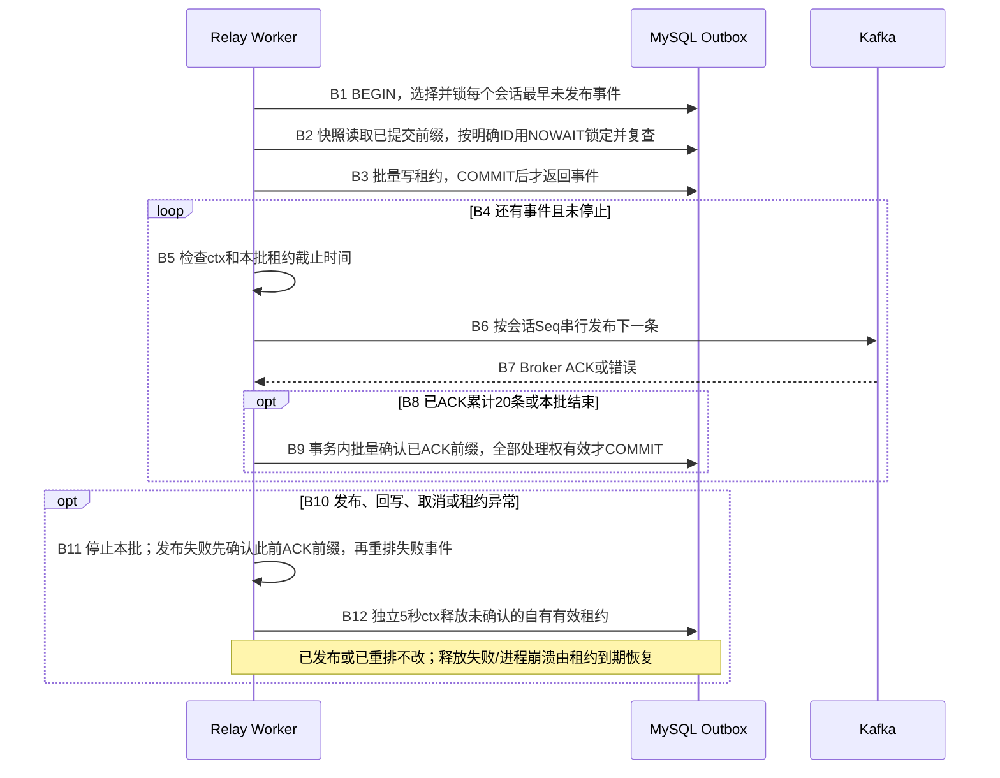

B3 COMMIT 未知不发布；B6 ACK 未知可以重复投递；B9 任一行处理权无效，整个确认事务回滚，不能只提交部分行。B12 只更新 owner 匹配、PROCESSING 且租约有效的记录，已发布、已重排、过期或被重新领取的记录保持不变。确认与释放结果未知按 Outbox 状态恢复，保留原 eventID/messageID。

`CheckpointSize=20` 只控制数据库确认批大小，Kafka 仍逐条同步 ACK；批尾不足20条立即确认。正常崩溃时可能重放当前尚未确认的 ACK 前缀，依赖下游幂等。任一发布或确认异常停止整批，其他会话尚未处理事件也释放；接受故障时的短暂停顿，保持恢复简单。租约120秒、无续租/fencing，仍要求单个有效 Relay。完整说明、测试与数据见 [批量优化报告](relay-batch-report.md)。

### 9.3 被替换的旧链路

目标架构不再包含：

```text
ChatMessageAcceptedEvent
→ chat-message-accepted-topic
→ Transfer Consumer
→ ChatMessageSequencedEvent
→ chat-message-sequenced-topic
→ Store Consumer与Push Consumer并行
```

Seq 职责没有消失，而是移入 `MessageWriteService` 的 MySQL 事务；Store 职责也没有消失，而是变成统一消息写入服务的一部分。

### 9.4 Redis 消息热缓存

消息热缓存继续保留，但不参与 Seq 签发，也不是消息存在性的事实源。`Message Cache Consumer` 与 `Realtime Push Consumer` 使用两个独立 Consumer Group 消费同一个 `ChatMessagePersistedEvent`：前者为已经落库的消息写入两种 Redis 投影并设置 TTL，后者负责在线推送。

```text
im:message-cache:{sessionID}:{seq}
→ 直接保存 `ChatMessage` 的消息内容热缓存，供离线同步读取

im:message:idempotency:v3:{senderID}:{clientMessageID}
→ 已落库发送结果，至少包含messageID、seq和fingerprint
```

`MessageWriteService` 在处理普通消息和红包消息命令时都先查询第二个 Key；命中且 fingerprint 一致时直接返回原结果，未命中或 Redis 不可用时查询 MySQL。红包命令命中缓存时还必须确认命令携带的预生成 `messageID` 与缓存一致。目标流程中缓存疑似冲突也先回源 MySQL 查证，持久化语义冲突才拒绝；当前代码的缓存冲突直接返回仍待调整。不能因为 Redis 未命中就生成新 `messageID`。

Message Cache Consumer 构建缓存时直接使用 `ChatMessagePersistedEvent` 携带的完整 `ChatMessage` 快照，不重新查询 `message` 表。该事件载荷与消息行在同一 MySQL 事务中写入，Redis 缓存只是已提交消息的投影；离线同步读取缓存未命中时仍以 MySQL 回源。

目标 Cache Consumer 根据已落库事件构建两种缓存，不复核事件携带的 fingerprint。它从 message 计算指纹用于幂等结果缓存；Push 不增加指纹校验。基本格式与必要字段校验继续保留，见 §9.6、D22。

离线同步先批量读取 Redis，缓存缺失、过期或 Redis 不可用时回源 MySQL。内容缓存直接保存 `ChatMessage`，不保存 Kafka 事件外壳；旧事件格式在读取时视为缓存未命中，回源 MySQL。缓存写入失败不能回滚已经提交的消息，也不能阻止实时推送；Consumer 不提交自己的 offset，恢复后独立重试。

### 9.5 离线同步（读路径）

离线同步是独立于第 9 节主链的读路径：它不写入任何事实表，不参与 Seq 签发，也不消费 Kafka。客户端重新上线后通过 Offline 服务的 HTTP 接口按会话游标拉取消息。本节步骤使用 `W` 前缀编号。

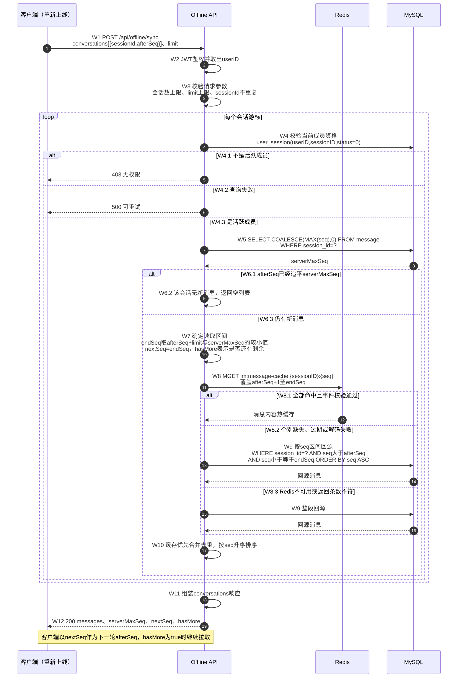

离线同步是纯读操作：W1–W12 全程不写 MySQL、不写 Redis、不产生业务事实，因此它没有幂等键，重试天然安全，游标 `sessionID + afterSeq` 就是恢复点。

客户端与实时推送的交接规则：Realtime 在连接加入本进程的连接管理器后发送 `connection.ready`；客户端收到该事件后立即对已知会话同步，重连时也重复同步。同步过程中收到的 `message.new` 直接按 `messageID` 合并展示，但不推进持久化的 `syncCursor`。每页同步结果先保存到本地，再以响应的 `nextSeq` 推进该会话游标；保存失败则保留原游标，下次重试可重复拉取并去重。客户端在线期间每 60 秒对已知会话做一次增量同步，以补偿已落库但实时通知丢失、后续也没有新推送的消息。`hasMore=false` 只表示追平该次请求读取的 MySQL 水位，不表示之后没有新消息。

边界分析：

| 故障步骤 | 处理决策 |
|---|---|
| W1 请求或响应丢失 | 无副作用，客户端用同一游标重发 |
| W2 鉴权失败 | 401，刷新凭证后重试 |
| W3 参数非法 | 400；会话数超过 MaxConversations、limit 超过 MaxLimit、sessionId 重复都属此列 |
| W4.1 不是活跃成员 | 403 拒绝，不返回该会话消息 |
| W4.2 或 W5 MySQL 失败 | 500 可重试，不产生部分成功 |
| W5 水位取值 | 当前取 `MAX(message.seq)`；目标链路下应与 `conversation_sequence.last_seq` 一致，出现空洞或计数器先行时需要重新确认以哪个为准 |
| W8.2 缓存缺失或过期 | 只对缺失的 seq 回源 MySQL；缓存过期不代表消息消失 |
| W8.3 Redis 不可用 | 不报错，整段回源 MySQL |
| W9 回源失败 | 500 可重试，不返回不完整结果 |
| Seq 存在空洞 | 空洞位置本就没有消息，返回条数可能少于 limit；`nextSeq` 仍按区间推进 |
| 任一会话失败 | 整个请求失败，当前实现是全部或全无，不做部分成功响应 |

与第 9 节主链的接点有两个：P8 说明用户离线时不做实时推送，由本节补齐；P9 与 P10 的 Message Cache Consumer 负责写入 W8 要读取的热缓存。

### 9.6 目标全流程：发送、事务 Outbox、Relay、Consumer 与 DLQ

本节是 2026-09-27 讨论后确定的目标图，覆盖普通消息与红包消息的汇合、两个消息 Topic、三个独立消费组和统一错误处理。Consumer 重试/DLQ、Cache 简化指纹、Push 排除发信人、红包发送资金事务和 Relay 租约检查已编码；完整跨服务故障验收仍未完成。前面的 §9 主线详图和 §9.2 Relay 详图保留用于对照既有实现，新实施以本节及 D18～D26 为准。红包 CacheBuild 是独立缓存预热支线，图中保留事务 Outbox 落点，其消费细节见 §11。

图中 Consumer 是三个独立 Reader/消费组的公共编排抽象，不是一个 Reader 同时运行三个 handler。每个 Reader 串行推进自己的当前消息；Kafka 可以在后台预取，但业务循环只有 C11 提交成功才再次调用 FetchMessage。所有等待和重试都响应服务 context 取消；图中的“退出”表示结束消费循环，不能继续走后面的提交步骤。

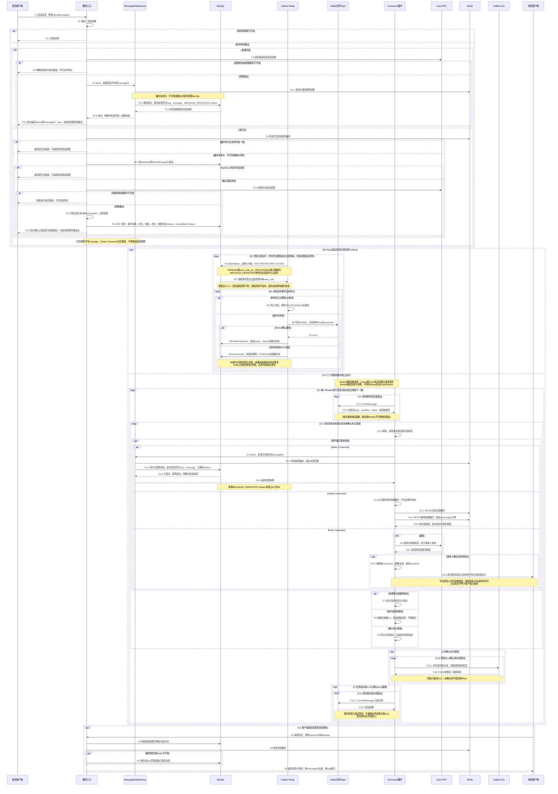

图中普通消息在 T3 校验发送权限；红包在幂等查证后由 T6.2 校验一次发送权限。U3 是读取权限；C6 只查询推送接收人，不重复审核发送权限。C6.2 按用户 ID 排除发信人，包含其所有登录设备；发信客户端通过 T5.5/T6.5 获得本次请求结果，其他设备通过同步读取补齐。红包发送成功并不提供聊天 Seq，仍需消息消费与同步补齐。Push 排除发信人的规则已在代码中实现。

C5 信任业务写入服务在消息事务内生成的已落库事件快照，保留解码、类型、版本及必要字段检查，不比较事件携带的指纹与重算指纹，也不为 Push 增加指纹校验。发送入口和 Message Writer 的幂等语义检查仍保留；Cache 按统一规则从 message 计算指纹，仅用于构建发送幂等结果缓存。同一事务保证 message 与 Outbox 一起提交，事件内容对应性由同一消息对象构造和验证来保证；取消指纹复核并不意味着任意内部错误都会被自动发现。

T5、T6 与后台 R/C 两条循环在运行时是异步关系：只要事务已经提交，Relay 即可发布，推送甚至可能先于客户端收到发送 ACK。T5 或 C4 幂等命中时不新增 Seq、消息或 Outbox；此前已经提交的 Outbox 自行完成后续传播。任何事务在 COMMIT 前失败均回滚；COMMIT 结果未知或查询暂未找到时保持 unknown，继续使用原幂等键查证，不能凭一次查无记录断言没有提交。

| 故障步骤 | 已存在的事实及可能的部分成功 | 客户端语义与恢复方式 |
|---|---|---|
| T2/T3/T6.2 参数拒绝或发送权限 RPC 失败 | 本次请求未写入新业务事实 | 明确参数/权限拒绝，或可重试；沿用原 clientMessageID |
| T3 或 T6.2 权限 RPC 返回允许后，提交前退群或群解散 | 普通消息事务或红包资金事务仍可能提交；RPC 校验与 MySQL 提交之间没有跨服务锁或原子检查 | 按 D27，将这次请求视为已通过发送资格检查；事务提交才产生成功事实。提交后按已落库事实推送，不在 Consumer 重新审核发送资格 |
| T5.2/T6.4/C4.2 事务明确回滚 | 本次事务没有部分提交；Writer 上游的红包资金事实仍可能已存在 | 普通请求返回错误；异步命令按错误分类重试或 DLQ，不能重复扣红包款 |
| T5.3/T6.4/C4.3 COMMIT 结果未知 | 事务可能已经整体提交，响应丢失不代表失败 | senderID + clientMessageID 查证；同内容返回原结果；查询也失败时不宣称成功或失败 |
| R2/R3 领取失败或结果未知 | Outbox 业务事实已存在；租约提交可能成功也可能回滚 | 不发布未确认领取的记录；下次轮询或租约到期重领，不撤销发送成功 |
| R5 尚未发布就租约到期 | 剩余事件仍在 Outbox，通常为 PROCESSING | 停止本批，不删除事件；以后按过期租约重新领取 |
| R6～R8 发布过程中租约过期，或 ACK 后标记失败 | Kafka 可能已有消息，Outbox 可能仍未标记 PUBLISHED | SQL 校验租约；后续可能重复发布，Writer 幂等、Cache 覆盖、客户端 messageID 去重；不承诺多 Relay 接管严格顺序 |
| R9 Reschedule 失败或结果未知 | 事件可能仍为 PROCESSING，也可能已回到 PENDING | 停止本批，依表中状态等待租约或 next_retry_at；Broker 可能已接收，允许重放 |
| C5.1 成功、C5.2 失败 | MySQL 消息已存在，Redis 只有一种缓存写入成功 | 不提交 Cache 组 offset；重试两种缓存写入，可覆盖同内容；不影响 Push 组自行处理 |
| C6 群成员查询失败 | MySQL 消息已存在，本轮未进行后续群推送 | 退避重试；这是获取接收人失败，不是重新判定发送权限失败 |
| C6.3 已入队后断线，或用户不在线 | 消息已落库，部分连接可能收到；入队数不等于收到数 | Push 可完成消费；U2～U6 同步补齐并去重，发信人本轮不在推送名单 |
| C8 临时/未知错误持续 | Writer 可能有 COMMIT 未知，Cache/Push 可能已有部分副作用 | 持有当前消息退避重试，阈值只告警；不提交更高 offset；用户查询与离线同步仍以 MySQL 为准 |
| C9 明确永久错误 | 当前事件被隔离，不能假设此前已提交的红包/消息不存在 | 进入 C10；DLQ 是待修复记录，不表示红包聊天消息或缓存已补齐 |
| C10.1 DLQ 发布失败或 ACK 未知 | 原 offset 未提交，DLQ 可能已有副本 | 仅重试 DLQ 发布；使用消费组 + 原 topic + partition + offset 识别重复 |
| C11 提交失败或进程在提交前崩溃 | 业务或 DLQ 已成功，Kafka 提交状态可能未知 | 当前进程重试提交；恢复后可能从已提交位置重放，保持原业务 ID 和 DLQ 原记录身份 |
| U4 缓存缺失或不可用 | message 事实仍在 MySQL | 回源；MySQL 读取失败返回可重试错误，不返回伪造的完整结果 |

永久错误只用于确认当前消息无法由原样重试恢复的情况；配置缺失、handler 未初始化、服务取消不进入 DLQ。未识别的运行时异常默认重试并告警，已确认无法继续运行的 Reader/配置故障退出并暴露错误，不靠提交原 offset 消除故障。DLQ 保留期必须覆盖人工处置窗口；修复后对失败消费组定向重放，保留原始定位信息，不自动向所有消费组广播重放。

## 10. Consumer 与 Kafka offset 决策

Kafka offset 只是读取游标，不是业务完成凭证。Outbox 的 `PUBLISHED` 也只表示 Broker 已接收。

对于会修改事实表的 Consumer，必须把业务修改与幂等约束放入同一个 MySQL 事务，或者使用 Inbox。当前设计中：

- 发红包资金操作由 API 的 MySQL 事务完成；`SendService.Send` 及相关事务 Model 已编码，真实数据库故障验收仍待完成；
- 抢红包资金操作也将在 API 的 MySQL 事务内完成；
- 退款资金操作也将在 MySQL 事务内完成；
- Message Writer Consumer 会修改消息事实，但 `message` 唯一约束、Seq 行锁和推送 Outbox 都处于同一事务；
- Push Consumer 和 Cache Consumer 不改变资金事实。

Consumer 的 offset 和独立兜底如下：

| Consumer | offset异常后的独立兜底 |
|---|---|
| Message Writer | 事务提交后才提交 offset；重复投递由 `messageID`、`senderID + clientMessageID` 和 `redPacketID` 唯一约束幂等 |
| Realtime Push | 只消费 `ChatMessagePersistedEvent`；`message` 表 + 离线同步 + 客户端 `messageID` 去重 |
| Message Cache | 从已落库事件生成消息内容缓存和发送幂等结果缓存；写 Redis 失败时保留当前消息并退避重试，不提交 offset；读取缓存缺失时可回源 MySQL |
| CacheBuild | `red_packet_share` + Redis miss时懒加载 + 后台重建 |

返回规则：

```text
临时基础设施错误 → 重试当前消息或暂停消费；不提交该分区更高的offset
永久协议错误或语义冲突 → 可靠写入DLQ并告警后，才允许提交原offset
明确用户离线 → return nil，离线同步兜底
副作用结果未知 → 允许重试和重复，依靠幂等
```

Message Writer 收到有效的红包消息命令后，正常完成路径只有以下两种情况可以提交 offset：

1. 新消息事务已经 COMMIT；
2. 已存在消息与命令语义完全一致，可以作为幂等成功返回。

COMMIT 结果未知时不能盲目分配新 Seq；不提交 offset，让 Kafka 重投后按持久化幂等键确认结果。

### 10.1 2026-09-24 历史实现缺口与消费策略

本节保留引入显式 offset 控制时的历史问题与决策；2026-09-27 的当前 Consumer 实现见 §10.3。

改造前 Realtime 的 Message Writer、Message Cache 和 Push 消费者都使用 `go-queue/kq`。`ForceCommit: false` 只让处理失败的那条消息跳过提交；消费循环仍会处理下一条。同一 partition 中，如果 offset 10 失败、11 成功并提交，消费组下次会从 12 开始，10 不会自动重试。`Processors: 1` 也不能消除这个缺口。现在三者均已改用下述显式提交方案；历史上被旧消费组越过的消息仍需核对并重放。

决策：先完成 Relay 主线，再优先改造会创建消息事实的 Message Writer Consumer。直接使用项目已有的 `segmentio/kafka-go` Reader：`FetchMessage` 取消息，`MessageWriteService` 事务提交或幂等命中后，才调用 `CommitMessages`；设置 `CommitInterval: 0`，同步确认提交结果。初版串行处理，将来并行处理时，每个 partition 只提交连续成功区间的最高 offset。

当前实现：`realtime` 的 Message Writer、Message Cache 和 Push 各使用自己的 Reader 与消费组，共用 `RunKafkaConsumer` 循环。每个循环一次处理一条消息；`Consume` 成功后同步提交当前 offset，再读取下一条。读取、处理或提交失败时返回错误，整个 Realtime 服务记录错误后退出；不会继续消费和提交更高 offset。Push 已检查出的格式、类型、版本和单聊接收者错误现在返回错误，不再静默确认。当前没有自动重试、错误分类、DLQ 或告警，恢复依赖进程重启后 Kafka 重投；永久坏消息会反复阻塞。缓存重复写入可覆盖相同键；推送重放可能产生重复通知，客户端按 `messageID` 去重。`StartOffset: FirstOffset` 只对没有已提交 offset 的消费组生效。

重试次数上限只能触发告警或人工介入，不能单独成为跳过消息的理由。永久无法处理的事件须先把原 topic、partition、offset、key、value、eventID、错误和消费组可靠写入 Kafka DLQ，Broker 确认后才提交原 offset；DLQ 写入失败则不提交。红包资金事务已成功而消息创建失败时，DLQ 是待修复债务，不是业务完成。MySQL 已提交但 offset 提交失败时，允许重放，由消息唯一约束和事务内 Outbox 幂等收敛。

三个消费者的基础 offset 控制已落地，但当前任何一个消费组的错误都会让整个 Realtime 服务退出，可用性代价较高。后续需要给临时故障补同一消息的退避重试，并为永久错误补可靠 DLQ 与告警；Push 仍只确认消息已进入服务端发送队列，不保证客户端收到，离线同步负责兜底。Kafka 事务不能自动原子化 MySQL 写入与消费 offset。故障验收尚未完成。

### 10.2 Consumer 结果模型与 Kafka DLQ 实施决策（2026-09-27）

实施目标是把 `Consume` 的结果收敛为三类，保持串行 `FetchMessage → Consume → CommitMessages`，不引入并行 offset 协调器：

| Consumer 结果 | Reader 行为 | 是否读取下一条 |
|---|---|---|
| `nil`，业务成功或幂等成功 | 同步提交当前 offset；提交成功后继续 | 是 |
| 普通 `error`，表示临时错误或无法确认的错误 | 不提交，按退避策略重试当前消息；达到阈值只告警并降低频率，不能自动转为永久错误 | 否 |
| 明确包装的 `PermanentError` | 将原消息和错误上下文同步发布到 Kafka DLQ；收到 Broker ACK 后提交原 offset | DLQ 和原 offset 均成功后才是 |

错误分类由各业务 Consumer 负责，`RunKafkaConsumer` 只执行统一策略。为了控制实现复杂度，只新增明确的 `PermanentError`；未分类错误一律按临时错误处理。永久错误的具体清单必须由开发者参与评审，AI Coding 可以完成公共错误类型、退避循环、DLQ Publisher、配置和接线。

DLQ 事件至少保存 `consumerGroup`、原 `topic`、`partition`、`offset`、`key`、`value`、错误类型、错误信息和发生时间。DLQ 发布失败或 ACK 未知时不能提交原 offset，继续保留当前消息。DLQ 发布成功但原 offset 提交失败时，重投可能产生重复 DLQ 事件；使用 `consumerGroup + topic + partition + offset` 作为稳定身份识别重复。本阶段使用 Kafka Topic，不新增 MySQL 失败表，也不建设 DLQ 管理平台；通过日志告警和人工查看、修复、重放完成闭环。

业务处理成功但 offset 提交失败时，当前进程优先重试提交；如果进程退出或发生消费组再平衡，允许业务被再次执行，并由 Message Writer 的唯一约束、事务内 Outbox、Cache 覆盖写和客户端 `messageID` 去重分别收敛。实现完成后必须从 `FetchMessage` 开始走读处理、临时重试、永久错误入 DLQ 和 offset 提交的完整路径。

### 10.3 Consumer 故障策略当前实现（2026-09-27）

`RunKafkaConsumer` 已按 §10.2 串行处理：Fetch 失败退避，普通业务错误重试当前消息，`PermanentError` 同步发布 Kafka DLQ 并等待 ACK，业务成功或 DLQ 确认后同步提交当前 offset；普通提交失败只重试提交。若提交返回 `IllegalGeneration`、`RebalanceInProgress` 或 `UnknownMemberId`，则停止当前 Reader 并报错，不让旧消息继续在新一代消费组中提交。重复尝试达到阈值只记录告警并最多等待 30 秒，不因次数跳过消息。服务 context 取消时退出并保留未提交 offset；缺依赖、Reader 关闭等明确无法继续运行的错误会让服务报错。三个 Reader 共用一个同步 DLQ Writer，退出时先停 Reader 再关闭 Writer。

### 10.4 三个 Consumer 的代码走读时序图

以下四图按当前代码画：第一图是所有 Consumer 共用的启动、取消息、错误分类和提交循环；后三图展开各自 `Consume` 的业务分层。三条消费链分别持有自己的 Reader 与消费组，Writer 读 `message-create-requested-topic`，Push 和 Cache 都读 `message-persisted-topic`，但使用不同消费组，互不代替提交 offset。

```mermaid
sequenceDiagram
    participant MAIN as realtime.run
    participant START as startConsumer闭包
    participant READER as kafka.Reader
    participant LOOP as RunKafkaConsumer
    participant HANDLER as 对应Consumer.Consume
    participant DLQ as Kafka DLQ Writer
    participant K as Kafka

    MAIN->>MAIN: 构造Manager、MessageWriter、Redis和三种Handler
    loop Push、Writer、Cache各启动一次
        MAIN->>START: topic、group、handler
        START->>READER: NewReader(Brokers, GroupID, Topic, CommitInterval=0)
        Note over READER: 配置Reader，Kafka连接按需建立
        START->>LOOP: 启动goroutine(ctx, reader, handler, group, dlq)
    end
    loop 每个Reader串行处理自己的下一条消息
        LOOP->>READER: FetchMessage(ctx)
        alt 临时读取错误
            READER-->>LOOP: error
            LOOP->>LOOP: 退避后重试Fetch，不提交offset
        else Reader已关闭且ctx未取消
            READER-->>LOOP: EOF或ClosedPipe
            LOOP-->>MAIN: error，停止Realtime服务
        else ctx取消
            LOOP-->>MAIN: nil，保留未提交offset
        else 读取成功
            READER-->>LOOP: message(topic、partition、offset、key、value)
            LOOP->>HANDLER: Consume(ctx, key, value)
            alt 返回nil
                HANDLER-->>LOOP: 业务完成或幂等成功
            else 返回普通error
                HANDLER-->>LOOP: 临时或结果未知
                LOOP->>LOOP: 退避并重试同一message，不取下一条
            else 返回PermanentError
                HANDLER-->>LOOP: 永久错误和原因
                loop 直到DLQ收到ACK或ctx取消
                    LOOP->>DLQ: Publish(原group、topic、partition、offset、内容、原因)
                    DLQ->>K: 同步发布DLQ记录
                    K-->>DLQ: ACK或错误
                end
            else 返回FatalError
                HANDLER-->>LOOP: 依赖缺失或不变量故障
                LOOP-->>MAIN: error，原offset不提交
            end
            opt Consume返回nil，或PermanentError已写入DLQ
                loop 直到提交成功、ctx取消或不可继续
                    LOOP->>READER: CommitMessages(ctx, message)
                    READER->>K: 同步提交此分区offset
                    K-->>READER: 结果
                    alt 普通提交错误
                        LOOP->>LOOP: 重试提交，不重新执行Consume
                    else 消费组代次失效或Reader关闭
                        LOOP-->>MAIN: error，恢复后可能重放
                    end
                end
            end
        end
    end
    Note over MAIN,LOOP: 任一goroutine报错进入consumerErrors；run退出时取消ctx、关闭三个Reader并Wait
```

**Writer：红包创建命令落库。** Realtime 普通消息从 WebSocket 直接调用同一个 `MessageWriteService.Send`，不经过这里的 Writer Consumer。Writer Consumer 只处理红包资金事务发出的 `ChatMessageCreateRequestedEvent`。

```mermaid
sequenceDiagram
    participant LOOP as RunKafkaConsumer
    participant WC as MessageWriterConsumer.Consume
    participant SERVICE as MessageWriteService.Send
    participant REDIS as 幂等结果Redis缓存
    participant WRITER as persistence.Writer.Persist
    participant DB as MySQL消息事务

    LOOP->>WC: Consume(create-requested的key、value)
    WC->>WC: 检查依赖、解码、事件类型与版本
    alt 依赖缺失
        WC-->>LOOP: FatalError
    else JSON或事件协议非法
        WC-->>LOOP: PermanentError
    else 协议有效
        WC->>SERVICE: Send(SourceRedPacket, Message, Fingerprint)
        SERVICE->>SERVICE: ValidateCommand与fingerprint检查
        alt 命令非法
            SERVICE-->>WC: ErrInvalidCommand
            WC-->>LOOP: PermanentError
        else 命令有效
            SERVICE->>REDIS: Lookup(senderID、clientMessageID)
            alt 缓存命中且内容与红包messageID匹配
                REDIS-->>SERVICE: 已落库的messageID、seq
                SERVICE-->>WC: 原消息，Created=false
            else 缓存未命中、不可用或疑似冲突
                SERVICE->>WRITER: Persist(command)
                WRITER->>DB: BEGIN；按幂等键查message
                alt 已存在且内容相同
                    DB-->>WRITER: 已落库消息
                    WRITER->>DB: COMMIT，不新增Seq或Outbox
                    WRITER-->>SERVICE: Created=false
                else 未存在
                    WRITER->>DB: Ensure并锁定conversation_sequence；Seq+1
                    WRITER->>DB: INSERT message
                    WRITER->>DB: INSERT ChatMessagePersistedEvent Outbox
                    WRITER->>DB: COMMIT
                    DB-->>WRITER: 已提交或错误
                    WRITER-->>SERVICE: Created=true或错误
                else INSERT撞唯一键
                    WRITER->>DB: 回滚后新事务按幂等键回查
                    DB-->>WRITER: 同内容、不同内容、查无记录或查询失败
                end
            end
            SERVICE-->>WC: 结果或错误
            alt 成功含幂等成功
                WC-->>LOOP: nil
            else 内容冲突
                WC-->>LOOP: PermanentError(idempotency_conflict)
            else 非幂等键唯一约束碰撞或核心依赖缺失
                WC-->>LOOP: FatalError，不跳过此offset
            else 数据库错误或提交结果未确认
                WC-->>LOOP: 普通error，重试同一记录
            end
        end
    end
```

**Push：只处理已落库事件，不修改消息或资金事实。** `Manager` 只保存本进程的用户连接；群成员 RPC 是查询接收人，不是重新审核发送权限。

```mermaid
sequenceDiagram
    participant LOOP as RunKafkaConsumer
    participant PC as MessagePushConsumer.Consume
    participant RPC as UserRPC.GetGroupMemberIds
    participant MANAGER as WebSocket Manager
    participant CLIENT as 本进程连接的客户端队列

    LOOP->>PC: Consume(persisted的key、value)
    PC->>PC: 检查依赖、JSON、事件类型版本、消息必要ID
    alt 依赖缺失
        PC-->>LOOP: FatalError
    else 坏事件或不支持的会话类型
        PC-->>LOOP: PermanentError
    else 事件有效
        PC->>PC: protocol.NewMessage并序列化为message.new payload
        alt 单聊
            PC->>PC: pushSingle检查receiverID有效且不同于senderID
            alt receiverID非法
                PC-->>LOOP: PermanentError(invalid_message)
            else 接收人有效
                PC->>MANAGER: SendToUser(receiverID, payload)
                MANAGER->>CLIENT: 尝试放入接收者的本地设备队列
                PC-->>LOOP: 返回nil
            end
        else 群聊
            PC->>RPC: pushGroup查询当前sessionID的成员，超时3秒
            alt RPC失败或返回nil
                RPC-->>PC: error
                PC-->>LOOP: 普通error，重试当前记录
            else 返回成员列表
                RPC-->>PC: userIDs
                PC->>PC: 过滤无效ID、重复ID、senderID
                loop 每个剩余接收人
                    PC->>MANAGER: SendToUser(userID, payload)
                    MANAGER->>CLIENT: 尝试放入该用户的本地设备队列
                end
                PC-->>LOOP: 返回nil
            end
        end
        Note over MANAGER,CLIENT: 入队数可以为0；不保证客户端收到，离线同步兜底
    end
```

**Cache：同一已落库事件生成两种 Redis 投影。** 它从消息内容重算 fingerprint，用于幂等结果缓存；不把事件自带 fingerprint 与重算值比较来判定消息冲突。

```mermaid
sequenceDiagram
    participant LOOP as RunKafkaConsumer
    participant CC as MessageCacheConsumer.Consume
    participant REDIS as Redis

    LOOP->>CC: Consume(persisted的key、value)
    CC->>CC: 检查依赖、JSON、事件类型版本、消息必要ID
    alt 依赖缺失
        CC-->>LOOP: FatalError
    else 坏事件或缺少必要ID
        CC-->>LOOP: PermanentError
    else 事件有效
        CC->>CC: 从message重算fingerprint并编码两种缓存值
        CC->>REDIS: Setex(sessionID + seq, ChatMessage)
        alt 内容缓存写失败
            REDIS-->>CC: error
            CC-->>LOOP: 普通error，重试同一记录
        else 内容缓存写成功
            CC->>REDIS: Setex(senderID + clientMessageID, messageID + seq + fingerprint)
            alt 幂等缓存写失败
                REDIS-->>CC: error
                CC-->>LOOP: 普通error；下次重写两种缓存
            else 两种缓存都写成功
                CC-->>LOOP: nil
            end
        end
    end
    Note over CC,REDIS: Redis不是消息事实源；缓存缺失由MySQL回源
```

复习时先看公共图的返回分流，再选一个业务图自顶向下追踪：`Consume` 只表达处理结果；是否重试、入 DLQ 或提交 offset 统一由 `RunKafkaConsumer` 决定。Kafka 已读取但 offset 未提交时，重放仍可能发生：Writer 依靠 MySQL 幂等，Cache 重写相同键，Push 则可能重复通知，客户端按 `messageID` 去重。当前 Push 只向本进程 Manager 中的连接入队；多 Realtime 实例的跨实例实时推送尚未解决。

| Handler | `nil` 的含义 | `PermanentError` | 普通 `error` | `FatalError` |
|---|---|---|---|---|
| Message Writer | 新消息事务已提交，或已有同内容消息幂等命中 | 坏事件、非法命令、同一幂等键的内容冲突 | 数据库等临时故障或结果无法确认 | 缺依赖、非幂等键唯一约束不变量故障 |
| Push | 本地接收人入队尝试已结束；入队数可以为 0 | 坏事件、非法消息、单聊接收者无效 | 群成员 RPC 失败或返回 nil、序列化失败 | 缺依赖 |
| Message Cache | 消息内容缓存与发送幂等缓存均写入 Redis | 坏事件、非法消息 | 指纹计算、序列化或 Redis 写入失败 | 缺依赖 |

DLQ Topic 为 `message-consumer-dlq-topic`，由 compose 初始化；实时服务配置增加 `Kafka.DLQTopic`。DLQ 记录包含 `consumerGroup`、原 topic/partition/offset、原 key/value 字节、可解出的 eventID、错误分类与信息、时间，以及稳定的原位置 ID。原 key/value 在 JSON 中以 base64 保存。ACK 未知时可能出现重复 DLQ 记录，原位置 ID 用于识别。

Writer 将非法 JSON、不支持的事件、无效命令和经 MySQL 持久化查证的幂等冲突分类为永久错误；缓存疑似冲突先回源 MySQL。Cache 对基本事件错误返回永久错误，Redis 失败重试；它从事件中的 message 计算幂等结果指纹，不复核事件携带指纹。Push 对基本事件错误、单聊接收人缺失或等于发信人返回永久错误，群成员 RPC 失败重试；群聊去重并按 userID 跳过发信人，单聊仅给接收人入队。实际客户端是否收到仍由离线同步兜底。

已用定向单元测试验证“业务临时错误后不跳过当前消息”“DLQ 首次失败后确认才提交”“提交失败不重新执行业务”“消费组代际变化时停止”“Cache 从已落库事件重算缓存指纹”和“单聊/群聊推送跳过发信人”；`go build ./...` 通过。真实 Kafka/MySQL/Redis 故障注入和人工 DLQ 修复重放尚未验收，不能把单元测试当成端到端保证。

## 11. CacheBuild Consumer 的准确职责

CacheBuild Consumer 是 MySQL 到 Redis 的缓存投影器，不保存资金事实。`REDPACKET_CACHE_BUILD` 事件只携带 `redPacketID`，Worker 收到后从已提交的 `red_packet` 构建发送结果幂等缓存，并从 `red_packet_share` 查询当前未领取份额来构建候选池。发送 API 只读取前者，未命中时回源 MySQL；API 不直接写发送结果缓存。

MySQL：

```text
share_id | amount | status
101      | 88     | UNCLAIMED
102      | 12     | UNCLAIMED
103      | 35     | UNCLAIMED
```

Redis：

```text
redpacket:{redPacketID}:available-share-ids
→ 101, 103, 102
```

Redis 主要保存 `shareID`，金额仍然从 MySQL 得到并验证。

构建流程：

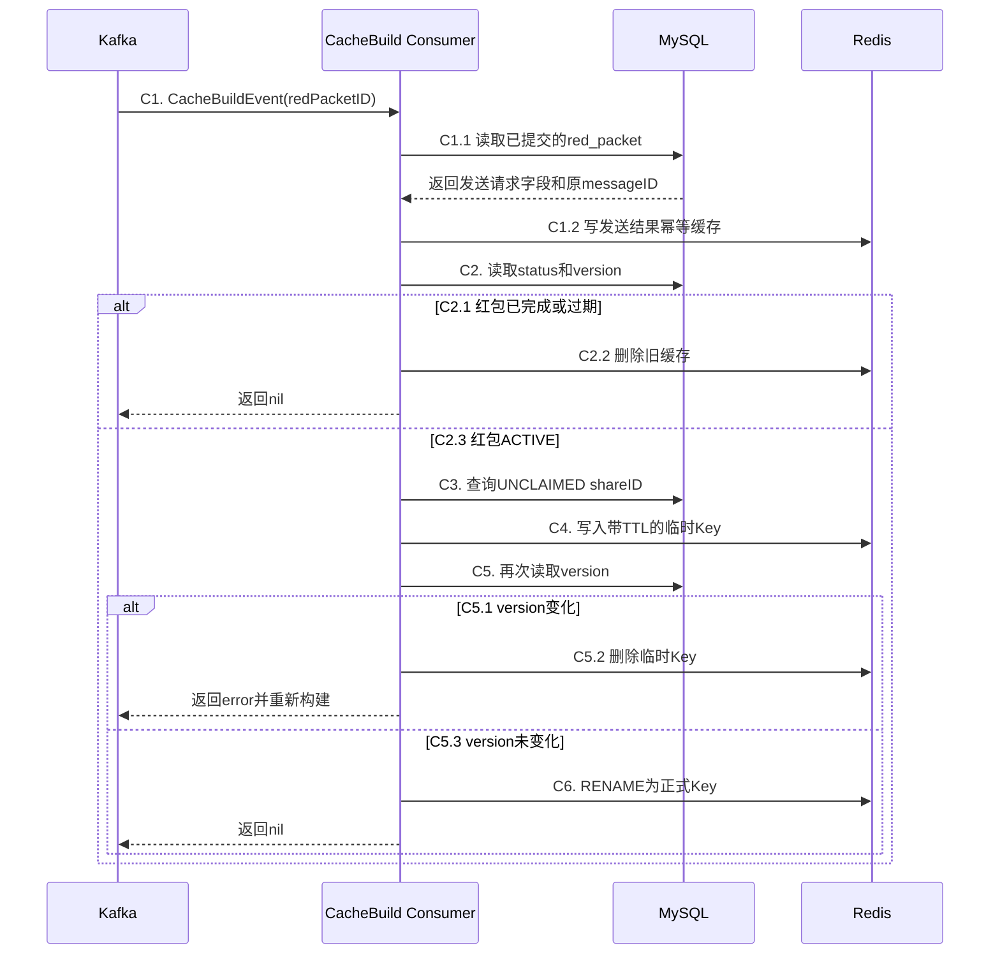

任一缓存构建失败都不提交本条 Kafka offset，后续重试；重复构建写入的是同一份已提交事实。CacheBuild Consumer 不是正确性必需组件：发送结果缓存未命中回源 MySQL，候选池缺失时直接从 MySQL 选择份额。当前选择保留份额预热，原因是群红包推送后通常会出现瞬时集中点击。

## 12. 抢红包完整数据流程

抢红包不采用“Lua成功后发Kafka，再由Consumer异步入账”的原项目方案。原因是 Redis 到 Kafka 存在双写窗口，且 Redis 不能作为资金事实。

已确定方案：Redis Lua 只提供候选 `shareID`；最终领取在同步 MySQL 事务中完成。领取、领完和过期状态由详情接口从 MySQL 读取，客户端按需刷新。

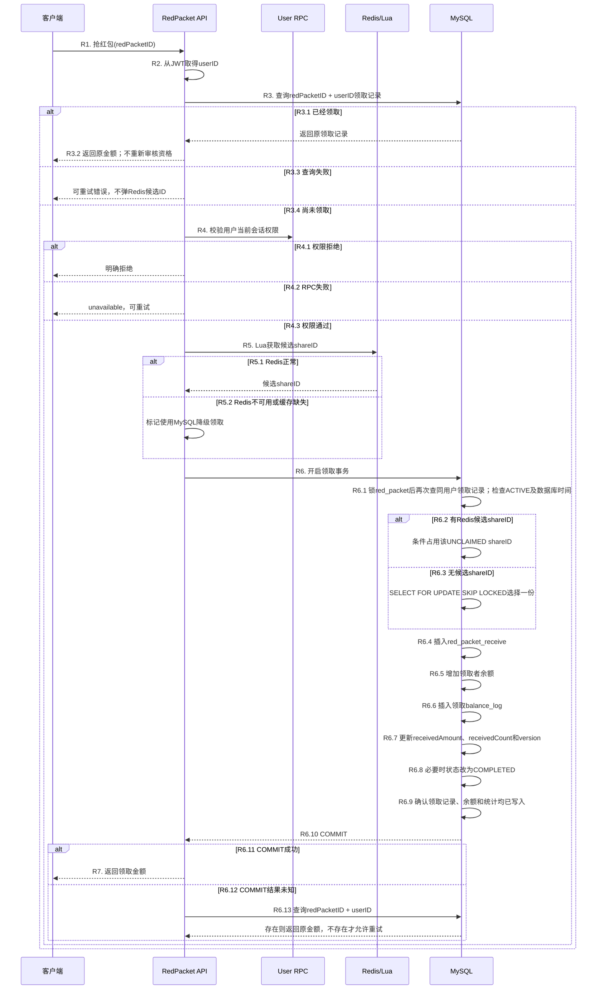

### 12.1 抢红包主要边界

| 故障步骤 | 处理决策 |
|---|---|
| R3 MySQL查询失败 | 不执行Lua，返回可重试错误 |
| R5 Redis失败 | 降级到MySQL领取 |
| R5 Lua弹出shareID后服务崩溃 | MySQL仍为UNCLAIMED；缓存少一项但钱不丢，可重建 |
| R5 返回陈旧shareID | MySQL条件更新影响0行，重新选择 |
| 两用户拿到同一shareID | 只有一个条件更新成功 |
| 同一用户并发领取 | R6.1 在红包锁内回查；`UNIQUE(red_packet_id, receiver_id)` 是最终防线。原领取成功后退群，同一请求仍可返回原结果 |
| R6任意子步骤失败 | 整个事务回滚 |
| R6 COMMIT结果未知 | 查询领取唯一键，不能再次盲抢 |
| R7响应丢失 | 重试后R3返回原金额 |

### 12.2 红包详情读取与主动刷新

客户端保留两个操作：`POST /api/redpacket/:redPacketId/receive` 同步领取，`GET /api/redpacket/:redPacketId` 读取详情。详情只额外返回已经成功领取的记录 `receives[{receiverId,amount,receivedAt}]`；不暴露 `shareID`，不另设“我的份额”接口。前端按当前 `userID` 从列表中找到自己的金额，红包领完时展示领取列表和已领完状态。`/sent` 列表只返回红包摘要，不逐个查询领取记录。

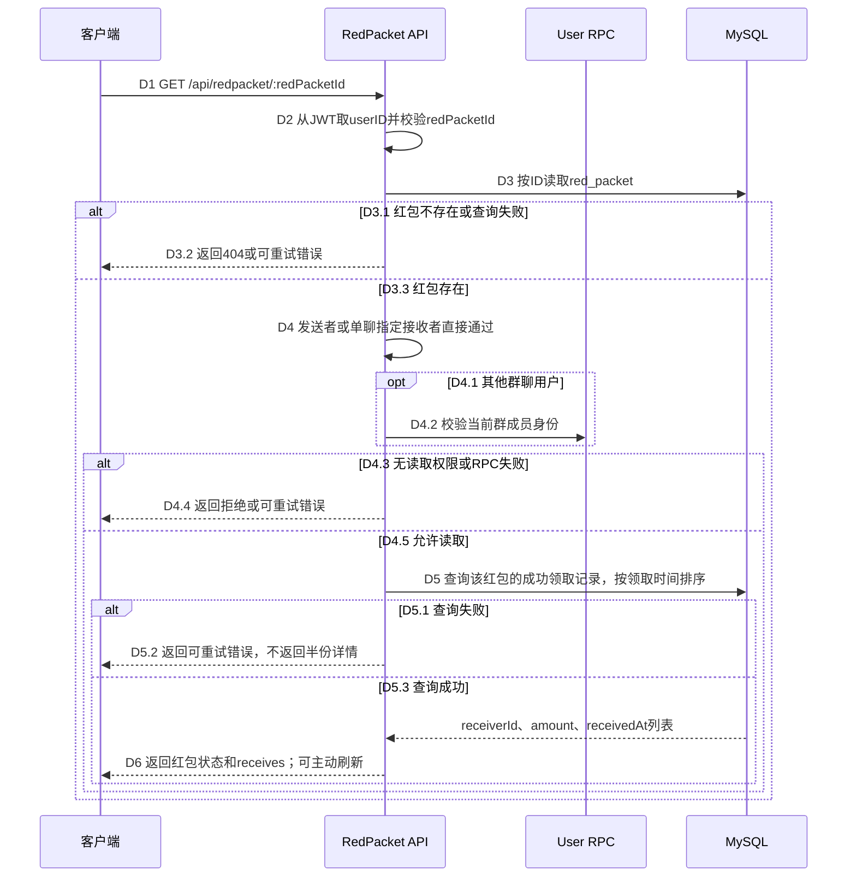

`D3` 和 `D5` 是普通只读查询，没有加锁或统一快照；并发领取时，主表计数和列表可能短暂不一致，下一次刷新会收敛。最多 100 份，首版一次返回全部记录。前端以领取接口的成功或幂等结果确认自己的领取；详情用于展示其他人的记录和最新状态。读取失败不影响资金事实。已领完根据 `status=COMPLETED` 或已返回的记录数达到 `totalCount` 展示；过期以服务端状态为准，若调度尚未更新，领取接口仍以数据库时间拒绝到期领取。

## 13. 过期退款流程

Redis ZSET 可以作为唤醒优化，但不能是唯一过期任务源。最终调度必须能扫描 MySQL：

```sql
WHERE status = 'ACTIVE'
  AND expire_at <= NOW()
```

剩余金额只按 MySQL 计算：

```text
remainingAmount = totalAmount - receivedAmount
```

不得遍历 Redis List 计算退款。

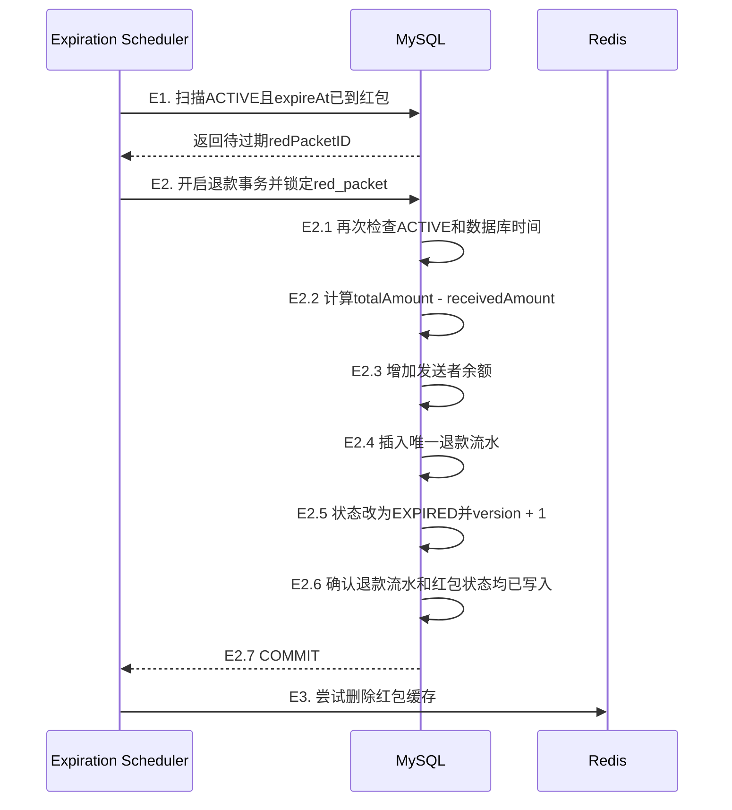

### 13.1 领取与退款竞争

领取事务和退款事务都会更新同一条 `red_packet`。MySQL 行锁决定顺序：

- 领取先提交：`receivedAmount` 增加，退款只退新的剩余金额；
- 退款先提交：状态变为 `EXPIRED`，领取事务的 ACTIVE 条件失败并回滚。

### 13.2 调度故障

- 调度服务宕机：恢复后继续扫描 MySQL；
- Redis ZSET 丢失：不影响 MySQL 扫描；
- 退款事务失败：全部回滚，下次再次扫描；
- COMMIT结果未知：查询红包状态和唯一退款流水；
- Redis清理失败：不影响退款，抢红包时以 MySQL 状态为准。

## 14. Redis 缓存重建

不能直接逐项覆盖正式 Key，应使用临时 Key 和版本检查：

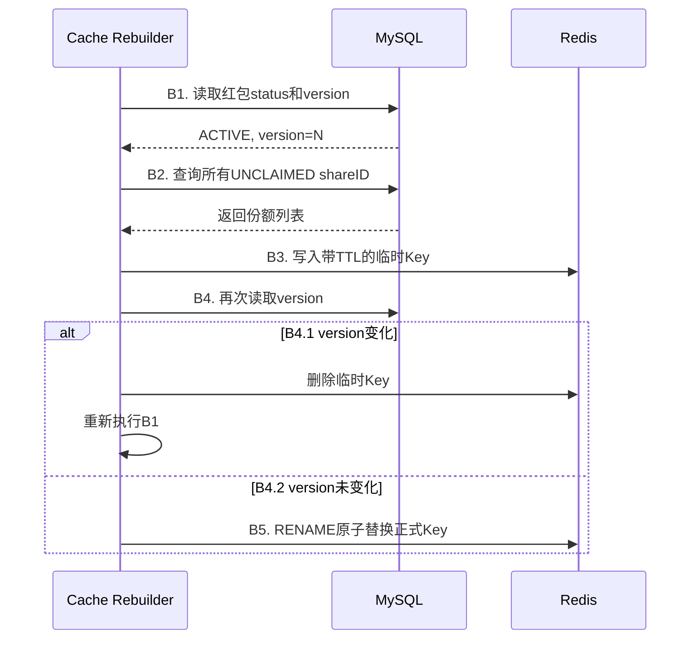

即使陈旧 shareID 偶尔进入 Redis，最终 MySQL 条件更新仍会拒绝已领取份额。

## 15. 当前项目需要调整的代码和表

实现时需要重点检查：

1. `common/model/event.MessageBody` 增加 `RedPacketID` 和红包文案字段；
2. `message` 表增加可查询的 `red_packet_id`，不能只把红包信息塞进普通文本；
3. Realtime 当前本地校验只允许文本消息；红包消息由 RedPacket API 服务端构造，不允许普通客户端伪造任意红包ID；
4. `red_packet` 表增加幂等键、统计字段、状态、版本和过期时间；
5. 新建 `red_packet_share`；
6. `balance_log` 增加业务唯一约束；
7. 红包资金事务中的 UserBalance、BalanceLog、RedPacket、Share 和 Outbox Model 支持同一个 `txctx`；
8. 消息事务中的 ConversationSequence、Message 和 Outbox Model 支持同一个 `txctx`；
9. `conversation_sequence` 从 Redis 号段高水位改为 MySQL 每会话 `last_seq`，由消息事务按 `sessionID` 行锁签发；为现有会话按 `MAX(message.seq)` 回填计数器；
10. 实现通用 Outbox Relay、处理租约、退避重试和 Broker ACK 后的状态更新；
11. 红包事务写 `ChatMessageCreateRequestedEvent` Outbox，Relay 投递到 `message-create-requested-topic`；
12. 新增 Message Writer Consumer，并让普通消息同步入口与该 Consumer 共用 `MessageWriteService`；普通消息由该服务生成 `messageID`，红包命令复用 RedPacket API 预生成的 `messageID`；
13. `MessageWriteService` 在一个事务内完成持久化幂等、普通消息ID生成或红包消息ID校验复用、Seq 签发、`message` 插入和 `ChatMessagePersistedEvent` Outbox；
14. Realtime Push Consumer 改为消费 `message-persisted-topic`，只推送已经落库的消息；
15. 新增 Message Cache Consumer，消费已落库事件并写入消息内容缓存及 `senderID + clientMessageID` 发送幂等结果缓存；保留 TTL、发送重试和离线同步的 Redis → MySQL 回源能力；
16. Offline 服务移除消息写入 Consumer，只保留离线增量同步读取职责；
17. 删除或退役旧版 accepted topic、Transfer Consumer、sequenced topic及其配置；
18. 离线同步改为基于 `WHERE session_id = ? AND seq > ? ORDER BY seq LIMIT ?` 的游标查询，避免逐个枚举 Seq，并为未来允许空洞保留演进空间；当前 MySQL 事务签发仍保证事务失败不产生空洞。

## 16. 消费失败处理与后续预留

### 16.1 DLQ

Message Writer、Message Cache、Realtime Push 以及红包 CacheBuild Consumer 的 Kafka DLQ 记录包含：

```text
原topic
partition
offset
key
value
eventID
consumerGroup
error类型
错误信息
发生时间
```

临时基础设施错误和未分类错误不能进入 DLQ，应在当前消息上退避重试。永久错误的详细处理顺序、去重身份与 offset 规则见 §10.2。本阶段不增加 MySQL 失败表、Retry Topic 或 DLQ 管理平台。

### 16.2 网关

当前网关按路径转发 User API、Offline、RedPacket API 和 Realtime WebSocket，也可提供前端构建文件；它原样转发 `Authorization`，由下游继续鉴权，不注入用户身份。转发路径和运行方法见 `service/gateway/README.md`。上游不可用返回 502，不改变红包事务的成功事实。若以后需要统一认证、限流和服务发现，必须再确定身份传递与故障语义；红包服务始终不能盲目信任客户端提交的身份字段。

## 17. 已接受的业务取舍

1. 当前阶段 Seq 在 MySQL 消息事务内按会话签发；事务失败时计数器更新一起回滚，不产生由写入失败造成的空洞。
2. 严格会话顺序意味着同一 `sessionID` 必须存在串行点；当前串行点是 `conversation_sequence` 的单行锁，不同会话仍可并发。
3. Redis 不再承担消息 Seq 正确性；Redis 故障可以降低红包缓存性能，但不能破坏资金或消息正确性。
4. 实时推送允许重复，客户端按 `messageID` 去重。
5. 用户离线时不永久保存每个成员的实时推送任务，依靠离线同步。
6. CacheBuild Consumer 是性能优化，不是业务正确性组件。
7. 抢红包不采用 Kafka 异步入账；领取事务同步完成，详情接口读取领取事实。
8. 过期任务以 MySQL扫描为最终保证，Redis ZSET只做优化。
9. 当前阶段不引入分布式事务；使用同库事务、两段 Outbox、唯一索引和幂等重试。
10. 红包 API 不写 `message` 表；红包消息最终由 `MessageWriteService` 写入，与普通消息共享唯一逻辑写入者。
11. 普通消息在 `message + MESSAGE_PERSISTED Outbox` 提交后返回 `stored`；红包发送成功只代表资金事务和消息创建 Outbox 已提交。
12. Push 只能消费 `ChatMessagePersistedEvent`，因此不会先推送后落库。
13. 不做常驻资金对账任务，只保留只读的按红包 ID 重算校验工具。
14. Redis 候选池缺失由「降级领取时重建」和「低频后台重建」两个触发点补偿。
15. 业务规则：群红包发送者可以领自己发的红包，单聊红包只有接收方能领；有效期固定 24 小时；红包总额上限 200 元、单份上限 200 元。

## 18. 产品规则：已定与待定

已定（2026-09-20）：

1. 群红包发送者可以领取自己发送的红包；
2. 单聊红包只有指定的接收方能领取，发送者不能领（与微信一致）；群红包按会话成员判定，发送者可以领自己发的包；
3. 红包有效期固定 24 小时；
4. 红包总额上限 200 元，单份上限 200 元。

待定项已按「模仿微信」拍板（2026-09-20）：

5. 份数上限：群红包最多 100 份；单聊红包固定 1 份。
6. 每份最低金额：0.01 元（1 分）。
7. 普通红包：每份金额相同，因此要求总金额能被份数整除，不整除直接返回参数错误（不做余数分配）。
8. 拼手气红包：每份随机，最低 1 分，单份不超过 200 元；建议用二倍均值法（每次在 [1 分, 剩余金额 ÷ 剩余人数 × 2] 内取随机），最后一份拿剩余；同时修复「101 分 100 人」这类会让线段切割死循环的参数。
9. 发送者退群：红包继续有效，其他成员可以继续领取；退群者本人不能再领该红包。
10. 群红包按领取时的当前群成员关系校验；红包发出后入群或重新入群的当前成员也可以领取，不保存创建时成员快照。
11. 领完后展示：不广播系统提示；打开或主动刷新详情时读取已领取记录和红包状态。
12. 客户端处理中状态：不展示；领取接口同步返回结果，超时由客户端用相同幂等键重试。

（原「单聊发送者能否领取」的待确认项已按微信规则解决：单聊红包仅接收方可领，见第 2 条。）

## 19. 后续说明与评审格式

后续讲解和评审必须使用：

- Mermaid `sequenceDiagram`；
- 每一个调用和关键本地步骤标注固定序号；
- 边界分析必须精确引用步骤编号，例如 `S8.7`、`M6.12`、`R6.10`；
- 先给完整主链，再讨论该步骤失败时的事实状态、客户端响应、幂等键和恢复方式；
- 避免只按 Redis/MySQL/Kafka 分类讲述，导致流程上下文割裂。

每个边界统一回答：

```text
1. 失败前已经存在什么MySQL事实？
2. 是否可能部分成功？
3. 客户端收到拒绝、可重试还是unknown？
4. 重试使用哪个幂等键？
5. 服务恢复后从哪张表、哪个状态继续？
```

## 20. 评审决议记录

### 2026-09-20

| 编号 | 议题 | 决议 |
|---|---|---|
| D1 | 红包消息写入路径 | 红包 API 不写 `message` 表；资金事务内写 `ChatMessageCreateRequestedEvent` Outbox，Relay 投递到 `message-create-requested-topic`，由 Message Writer Consumer 调用统一写入服务 |
| D2 | 资金对账任务 | 不做常驻对账；保留只读的按红包 ID 重算校验工具（校验 `receivedAmount`、总额守恒、`balance_log` 完整性） |
| D3 | Redis 候选池补偿 | 两个触发点：MySQL 降级领取时重建该红包候选池；低频后台对比 UNCLAIMED 份额数与候选池长度，不一致则重建（版本校验 + RENAME） |
| D4 | 业务规则 | 群红包发送者可领自己的红包，单聊红包仅接收方可领；有效期 24 小时；总额上限 200 元、单份上限 200 元 |
| D5 | 群红包领取资格 | 不保存创建时成员快照；领取时仍为当前群成员即可领取，退群成员不能领取 |
| D6 | 客户端幂等ID | 红包与红包消息一一对应，统一使用 `clientMessageID`；`senderID + clientMessageID` 同时约束红包发送和消息落库幂等，不再单独引入 `clientRequestID` |

D1 的取舍：消息可能晚于扣款出现。收口方式是 Outbox 重试、Message Writer 幂等与告警，加上发送者可查询「我发出的红包」，不依赖消息存在。

### 2026-09-21

| 编号 | 议题 | 最终决议 |
|---|---|---|
| D7 | 普通消息落库与推送双写 | 普通消息同步调用 `MessageWriteService`；在同一事务内插入 `message` 和 `ChatMessagePersistedEvent` Outbox，COMMIT 后返回 `stored` |
| D8 | 红包与普通消息共用写入逻辑 | 红包消息通过 `message-create-requested-topic` 异步进入同一个 `MessageWriteService`；只有该服务拥有 `message` 写权限 |
| D9 | Seq 签发 | Seq 移入消息 MySQL 事务；按 `sessionID` 锁定 `conversation_sequence` 行，计数器更新、消息插入和推送 Outbox 一起提交或回滚 |
| D10 | 消息推送入口 | Realtime Push Consumer 只消费 `ChatMessagePersistedEvent`，不再消费未落库事件 |
| D11 | 旧消息链路 | 退役 Accepted Event、Transfer Consumer、Sequenced Event 和 Store Consumer；其职责分别由持久化入口、事务内 Seq 和 `MessageWriteService` 接管 |
| D12 | Relay会话顺序 | `MESSAGE_PERSISTED` 保存 `aggregateSeq=message.seq`，Kafka Key 为 `sessionID`；初版单有效Relay按会话顺序发布，扩容时按sessionID固定分片 |
| D13 | messageID生成权 | 普通消息由 `MessageWriteService` 在持久化幂等未命中后生成；红包消息由 RedPacket API 在资金事务前预生成并随创建命令传递，Message Writer 必须复用 |
| D14 | Redis消息缓存 | 保留 `sessionID + seq` 短期热缓存；改由独立 Message Cache Consumer 在收到 `ChatMessagePersistedEvent` 后写入，离线同步缓存未命中时回源 MySQL；Redis 不参与 Seq 正确性 |
| D15 | 消息发送幂等缓存 | 保留 `senderID + clientMessageID → messageID + seq + fingerprint` 快速查询；只缓存已经落库的消息，未命中或Redis不可用时回源MySQL，不再使用Redis SETNX预占未落库messageID |
| D16 | 迁移开关 | 新旧消息链路用 `MessagePipeline.Mode=legacy/outbox` 暂时并存；在消息事务和Relay核心完成端到端验收前默认保持legacy，验收后切换outbox并删除旧链路 |

### 2026-09-23

| 编号 | 议题 | 决议 |
|---|---|---|
| D17 | Consumer 失败与 offset 越过 | 发现 `kq` 在 `ForceCommit: false` 时仍可能由后续成功消息提交更高 offset，导致失败消息被消费组越过。决定用 `kafka-go` 显式消费与同步提交；业务处理成功后提交，临时失败阻塞/暂停当前消费，永久失败须可靠进入 DLQ 并告警后才提交。Message Writer、Cache 和 Push 的基础 Reader 改造状态见 §10.1。 |

### 2026-09-27

| 编号 | 议题 | 决议 |
|---|---|---|
| D18 | Consumer 结果模型 | 结果只分为成功、临时/未知错误、明确永久错误。普通错误默认可重试；重试次数只能触发告警和降低频率，不能自动跳过。保持单 Reader 串行处理，当前消息完成前不读取并提交后续 offset。 |
| D19 | 永久错误与 DLQ | 使用 Kafka DLQ，不新增 MySQL 失败表。永久错误必须先同步发布 DLQ，Broker ACK 后才能提交原 offset；DLQ 失败则继续阻塞当前消息。以 `consumerGroup + topic + partition + offset` 标识原消息，接受 DLQ 重复。永久错误清单由开发者参与评审，公共机制交给 AI Coding 实现。 |
| D20 | Relay 租约简化 | 保留 `BatchSize=100`，适当延长租约；发布前在 Worker 检查 `lease_until`，状态回写 SQL 同时检查租约仍有效。当前只运行单个有效 Relay，不实现续租或 fencing token。Kafka 调用期间租约过期仍可能导致重复发布，明确接受至少一次语义并依赖下游幂等。 |
| D21 | 实施与学习分工 | 面试准备重点放在业务设计、状态转换和失败边界；AI Coding 负责主要代码实现、配置、接线和机械验证。开发者参与永久错误归类、红包资金事务和关键取舍评审，并在每阶段完成后走读整条执行路径。 |
| D22 | 简化消费指纹检查 | Cache 信任消息事务内生成的已落库事件快照，取消事件携带指纹与重算指纹的比较；从 message 计算指纹只用于幂等结果缓存。Push 不增加指纹校验。发送入口和 Writer 保留幂等语义检查，缓存疑似冲突回源 MySQL 查证；三个 Consumer 保留必要的协议和字段校验。 |
| D23 | 推送接收人与发送权限 | 发送权限在业务写入前校验，Push 的群成员 RPC 仅查询当前接收人。单聊向接收者、群聊向去重成员推送，按 userID 排除 senderID 的所有设备。发信端靠请求结果与本地消息状态，其他设备通过同步读取补齐；入队不代表客户端收到，离线同步兜底。此规则已在 Push 代码落地，故障验收待完成。 |
| D24 | Consumer 第一阶段交付 | 业务、DLQ、提交三个重试阶段分别保留当前消息。Kafka DLQ 共用单个同步 Publisher，`CommitInterval=0`；达到重试阈值仅告警不跳过。AI Coding 已完成三个 Consumer 的首批错误分类、配置接线和定向验证；永久错误清单与人工修复流程在跨服务故障验收时继续复核。 |
| D25 | 消息唯一键竞争与幂等确认 | `message` 保留普通 `INSERT` 和多个唯一约束。插入遇到 MySQL 1062 时回滚当前事务，再用新事务按 `senderID + clientMessageID` 回查：找到且业务内容一致（红包还须匹配预生成 `messageID`）则返回已有消息和 `Created=false`；找到但内容不同返回幂等冲突；按幂等键找不到行则报告唯一约束不变量故障，使 Consumer 停止并告警，不能当作坏事件放入 DLQ 后跳过。回查通过结果判断能否视为幂等成功，并不直接识别触发 1062 的具体索引。选择显式撞键再回查，是因为 `INSERT IGNORE` 或 `ON DUPLICATE KEY UPDATE` 本身无法证明内容一致；表上还有 `messageID`、`sessionID + seq`、`redPacketID` 等唯一约束，不能把任意撞键都当作重复请求。回查沿用当前事务模型，不另改为普通查询。 |
| D26 | 红包发送与 Relay 本轮落地 | 发红包先检查 Redis 幂等缓存，再按 `senderID + clientMessageID` 查 MySQL；已提交的同内容请求直接返回原 `redPacketID/messageID`，因此成员后来退出群聊也不改变原请求结果。只有确认是新请求后才做权限 RPC。红包发送事务按顺序执行条件扣款、插入红包、全部份额、扣款流水、消息创建 Outbox 和 CacheBuild Outbox；任何步骤失败整体回滚。事务返回错误时按幂等键回查以处理并发及 COMMIT 结果未知。Relay 保留批量 100，将示例租约延至 120 秒；每次发布前检查本批租约截止时间，`MarkPublished`/`Reschedule` 仅在持有者且租约未过期时更新。Kafka 发布过程中租约仍可能过期，允许重复发布并依赖下游幂等。Redis 缓存、CacheBuild 消费和真实基础设施故障验收不参与资金事务的成功判定。 |
| D27 | 发送权限与提交之间的群状态竞态 | 普通消息和红包发送对新请求先调用 User RPC 校验发送资格，再开启各自的 MySQL 写入事务。RPC 返回 `Allowed` 后，发送者退群或会话解散不撤销这次请求的已通过校验结果；事务仍可继续，只有事务提交才表示消息或红包资金事实成功。RPC 拒绝或不可用时不能开始新写入；同内容的已提交幂等重试直接返回原结果。下游 Message Writer 与 Push 不重新审核发送资格。当前 RPC 读会话和成员、消息/红包写入不在同一个事务中，不能保证提交瞬间仍具有群成员身份；落库表也没有依赖 `session` 存在的外键约束。若将来产品要求解散/退群与发送提交严格排序，必须重新设计共享的原子检查或锁协调，单纯在提交前多调用一次 RPC 不能消除时间窗口。 |
| D28 | 领取、退款与缓存候选池落地 | 新领取先查 `red_packet_id + user_id` 的既有领取记录，再校验当前成员资格；已成功领取的重复请求即使后来退群，也返回原领取结果。Redis Lua `RPOP` 只给出候选 shareID；Redis 故障、空池或陈旧 ID 时回到 MySQL 选择 `UNCLAIMED` 份额。领取事务锁 `red_packet`，同事务完成份额占用、唯一领取记录、余额增加、领取流水、主表已领取金额与份数及通知 Outbox。退款调度扫描 MySQL，到期后锁同一红包并重查状态，按 `total_amount - received_amount` 退款、写唯一退款流水、更新状态与通知 Outbox。事务返回错误时按红包状态和唯一退款流水确认结果；扫描按到期时间与 ID 分页，单个故障红包不阻塞后续退款。CacheBuild 在独立 Worker 中从已提交份额重建 Redis 列表，低频后台比较未领份数和缓存长度以修复候选 ID 丢失。两种资金事务依靠主表行锁串行，同一热门红包存在热点行吞吐上限；Cache 只是性能投影，MySQL 仍裁决领取和退款。新功能已编码并通过 Go 测试，真实数据库与消息代理故障验收尚未完成。 |
| D29 | 红包发送结果缓存归属 | 普通消息 Cache Consumer 直接使用与 `message` 同事务提交的 `ChatMessagePersistedEvent` 完整快照；红包 CacheBuild 事件只传 `redPacketID`，Worker 回查已提交的 `red_packet` 和当前未领取的 `red_packet_share`。两者都只投影已提交事实，但构建时的数据来源不同。红包 API 读取发送结果缓存，未命中时查 MySQL；事务提交后和幂等回查后不直接写 Redis。任一步缓存构建失败均保留当前 Kafka 消息重试，缓存延迟只影响命中率，不影响发送结果和领取的 MySQL 判断。 |

### 2026-09-29

| 编号 | 议题 | 决议 |
|---|---|---|
| D30 | 红包领取状态展示 | 保留领取接口和单个红包详情接口。详情鉴权后从 `red_packet_receive` 返回成功领取者、金额和时间；前端按当前用户 ID 找自己的份额，并在打开详情或主动刷新时更新。允许短暂展示延迟，不要求主表计数与列表来自统一快照。移除领取、领完、过期的生命周期通知 Outbox、Kafka Topic 和 Realtime Consumer；红包发送的消息创建 Outbox 和 CacheBuild Outbox 保留。此决议取代 D28 中的“通知 Outbox”和第 18 节旧的领完广播规则。 |

### 2026-10-06（10 月 5 日负载复测）

| 编号 | 议题 | 决议 |
|---|---|---|
| D31 | 连接预算与 Relay 连续处理 | 7 个进程在创建 Model 前经 `common/mysqlpool` 配置共享连接池，示例最大连接数合计 96；缺少配置默认各进程 16，扩容需重新合计预算。Relay 整批成功且有任务立即开始下一批，空批或错误才等待完整轮询间隔；保留会话最早未发布 Seq、租约与 Broker ACK 规则。本轮不修改资金事务、领取查询 SQL 或请求超时。优化轮 13 组、17,541 次请求无服务错误，资金、Seq 和观察连接推送顺序核查通过；100 并发热门会话推送 P95 仍约 47 秒，不能宣称实时容量全面达标。证据与面试素材见 `load-optimization-report.md`。 |

面试边界：相同请求并发写入时，一个事务可提交，另一个可能先被唯一键拒绝，再回查并返回幂等成功；不同内容复用同一幂等键必须报冲突。回查时的数据库故障属于可重试错误；撞到其他唯一约束而按幂等键找不到消息时，Consumer 停止并告警，不提交该 offset。

### 2026-10-06 Relay 索引验证

| 编号 | 议题 | 决议 |
|---|---|---|
| D32 | Relay 前序检查与分段计时 | 新增默认关闭的 `Relay.LogTimings`，分别记录领取事务、同步 Kafka ACK、状态回写和失败重排。原压测库副本的执行计划确认前序检查反复扫描已发布历史；增加覆盖索引 `(aggregate_type, aggregate_id, event_type, status, aggregate_seq)`，不改领取谓词、租约、ACK 或单有效 Relay 规则。两轮各 6 组固定 600 条消息及领取/同步回归共 15,960 请求，通过资金、Seq、观察连接顺序与积压核查。100 并发热门会话推送 P95 约 47.5 秒降到 9.6 秒，但发送 ACK 与高并发多会话未全面改善。真实 MySQL 验证前序被锁住、发布失败等待重试和租约失效；仍不承诺多 Relay 严格顺序或生产容量。详见 `relay-performance-report.md`。 |

### 2026-10-06 连续领取和确认批次

| 编号 | 议题 | 决议 |
|---|---|---|
| D33 | 连续 Seq 与已 ACK 批量确认 | 用户认可在保证准确性下扩大领取尺度。示例批量500，先锁会话最早未发布事件，MVCC读取已提交前缀后按明确ID加锁，不包含Writer未提交尾部；NOWAIT中间锁冲突回滚，未来重试/有效租约截断；整批一次写租约。Kafka逐条同步ACK、保持会话内顺序，每20条ACKed前缀在一个事务确认；处理权部分失效则整个确认回滚。异常停止整批，未确认自有有效租约释放，已重排/发布不改；释放失败或崩溃靠租约恢复。增加重复窗口，依赖下游幂等；保持单有效Relay、120秒租约，无续租/fencing。取代D20的批量100以及D31/D32的每会话每批一条、逐条回写方式，现行图见§9.2.4。 |

## 21. 实施进度与后续计划

已完成阶段 0～3 的机械骨架：

- 群红包领取资格改为领取时校验当前群成员，不保存创建时成员快照；
- Snowflake 改为每个进程显式配置独立 NodeID；
- 补齐红包、份额、领取、Outbox、余额流水和消息关联字段的表结构；
- 生成红包 Model、8103 API、鉴权、User RPC、配置与 ServiceContext 接线；
- 消息事件和离线消息模型已能携带 `redPacketID` 与红包文案；
- 发红包入口已连接 `SendService`，但核心事务保持显式 TODO，调用时返回未实现错误，不会返回假成功。

2026-09-21 又冻结了新版消息架构，并完成了不涉及核心事务的迁移骨架：

- 新增 `ChatMessageCreateRequestedEvent`、带 fingerprint 的 `ChatMessagePersistedEvent` 和统一消息 fingerprint；
- 新增 `MessageWriteService`，已完成 Redis 已落库结果快路径、命令校验以及普通消息/红包消息的统一入口；
- 新增 Message Writer Consumer 和 Message Cache Consumer；后者同时写消息内容缓存与 `senderID + clientMessageID` 发送幂等结果缓存；
- 新增消息持久化 Writer、Message/ConversationSequence/Outbox 三个事务 Model 契约，以及 Outbox Relay 的 Store/Publisher/Worker 骨架；
- Realtime 和 Offline 增加 `MessagePipeline.Mode=legacy/outbox` 迁移开关；outbox 模式下 Push 只消费持久化事件，Offline 不再启动 Store Consumer；
- 离线同步已能读取新版持久化事件缓存，并在缺失时使用 Seq 范围查询回源 MySQL；
- 新增目标 Kafka Topic/Consumer Group 配置，`conversation_sequence.last_seq` 和 `outbox_event.aggregate_seq` 表结构；为兼容当前可运行链路，旧 topic、Transfer 和 `reserved_max_seq` 暂时保留；
- `go test ./...` 已通过。

上述内容是 2026-09-21 的历史快照。到 2026-09-27，消息持久化 Writer、ConversationSequence 事务、`MESSAGE_PERSISTED` Outbox、Relay 领取与发布、三个 `kafka-go` Reader 以及旧链路删除均已落地。

本轮又完成 Relay 发布前租约检查及状态回写的租约条件，和红包发送的金额拆分、幂等判定、权限查询、条件扣款、事务内红包/份额/流水/两条 Outbox 写入及事务错误后的回查确认。代码构建与相关 Go 单元测试通过；真实 MySQL、Redis、Kafka 的事务和故障注入验收尚未完成，因此不能把发送路径称为已完成端到端验收。发送成功只表示资金与两条 Outbox 在一个 MySQL 事务中提交，消息落库及缓存预热随后异步完成。

红包领取、过期退款、CacheBuild Consumer、候选池重建、查询接口和只读资金对账工具已编码。红包 Worker 消费 `redpacket-cache-build-topic`，构建红包发送结果缓存与份额候选池，扫描 MySQL 到期红包并定期修复候选池。红包详情在权限检查后读取成功领取记录，客户端可以主动刷新；领取和退款事务不再创建生命周期通知。当前只进行了代码级 Go 测试；真实数据库并发、Kafka 重投和 Redis 故障尚未验收，不能把编码完成等同于端到端交付。现有 Message Cache Consumer 只处理已落库聊天消息的内容缓存与发送幂等缓存，不负责红包份额候选池或红包发送结果缓存。

资金和领取事实可通过红包查询接口从 MySQL 获取。主动刷新允许展示延迟；离线聊天消息同步是另一条链路，后续单独走读。

运行装配：Worker 的 Snowflake NodeID 必须与 API 及其他服务不同；只读资金核查命令位于 `service/redpacket/audit`，使用 `IM_MYSQL_DSN` 与 `-packet-id`，核对主表统计、份额、领取记录和流水；它不修改资金事实。新版本不再产生或消费红包生命周期通知事件。已有环境切换前按 `event_type IN ('redpacket.received','redpacket.completed','redpacket.expired')` 查询旧 Outbox 的状态；如仍有待发布记录，暂留旧 Topic 让 Relay 发布完毕，确认已无 PENDING/PROCESSING 后再退役 Topic，避免 Relay 对不存在的 Topic 持续重试。

### 2026-09-27 后续执行顺序

1. 已完成 §10.2 的 Consumer 结果模型：公共 `PermanentError`、当前消息退避重试、提交失败处理和日志告警；细节见 §10.3。
2. 已完成 Kafka DLQ Publisher 与配置，并完成 Writer、Cache、Push 的首批错误分类；按 D22 取消 Cache 指纹复核，缓存疑似冲突回源；按 D23 排除发信人。永久错误分类仍需开发者在故障验收中复核。
3. 已完成 `RunKafkaConsumer` 主循环和 Writer Consumer 的走读；Push、Message Cache 两个 Consumer 的 `Consume` 细节由开发者后续补读。真实基础设施上仍需验收“成功提交、临时错误重试、永久错误入 DLQ、DLQ 失败不提交、提交失败允许重放”。
4. 已按 D20 完成 Relay 的发布前租约判断和状态回写条件，保留批量 100，示例租约为 120 秒；需在真实 MySQL/Kafka 上验证过期、重领和重复发布边界。
5. 已按 D26 编码 `SendService.Send` 红包资金事务；开发者后续走读事务 SQL 和 COMMIT 结果未知的回查路径。资金事务尚需真实数据库验收。
6. 已补红包领取、过期退款、CacheBuild Consumer、候选池重建和查询接口；生命周期通知链路已按 D30 移除。接下来对普通消息、红包消息、DLQ、Relay 重投、资金事务、缓存、详情查询和离线同步做真实基础设施故障验收，并把结果回填到时序图。

### 2026-10-05 单节点真实验收

已使用独立测试库与 Kafka Topic 完成 21 项真实后端验收，以及生产页面和同步/实时交接两组浏览器验证。范围包含网关、普通/红包消息、发送与领取幂等、并发领取、SQL 回滚、过期竞争与退款、缓存回源、Outbox 重放、Kafka/Redis 停机恢复，以及 12 个红包和 16 名用户的余额流水核查。

验收修复了领取/退款直接扫描 `time.Time` 导致 SQL 映射失败，以及消费组网络 EOF 被当成主动关闭、令 Realtime 退出的问题。Realtime 和红包 Worker 现共用 `common/kafkareader`，网络 EOF 进入原有重试，主动 Close 和消费组代次失效仍按停止策略处理。Redis 整体宕机会影响鉴权和权限 RPC；恢复后还可能有旧连接错误，客户端继续使用原幂等键重试。

此前“真实基础设施未验收”的文字保留为历史进度。本轮通过范围与未覆盖项以 [验收报告](acceptance-report.md) 为准；精确 COMMIT/ACK 丢失、租约接管、真实 DLQ 故障与人工重放、旧库迁移、容量测试和多节点扩展尚未完成。红包前端的后续接入见下节。

### 2026-10-05 红包前端接入

已按 D30 接入发红包、红包消息卡片、领取和详情。详情展示当前用户领取金额与成功领取记录，打开和主动刷新时更新；不消费生命周期通知。发送结果未知时在浏览器保存原请求，重试复用 `clientMessageId` 与全部业务字段。资金提交后可以先展示发送人的红包卡片，随后同步补齐消息；发送结果不包含 Seq，不能推进同步游标。

经生产网关的双账号浏览器验证通过群红包发送与领取、群发送人自领、领完刷新、单聊仅接收人领取、刷新恢复卡片，以及响应丢失后重开弹窗重试原请求并返回原 ID。具体证据与仍未覆盖项见验收报告。

### 2026-10-05 本机负载边界

后续负载测试确认资金与 Seq 核查正确，但暴露 MySQL 连接预算、热门红包锁等待/请求超时，以及热门会话有序 Outbox 的发布积压。Relay Kafka Writer 增加 `BatchSize=1`，避免同步单条发布每次等待默认 1 秒攒批；资金事务、租约规则、200ms ticker 与每会话最早未发布 Seq 的领取规则不变。领取发生了 1 次数据库已入账但 API 未成功响应，再次印证客户端必须按原红包与用户查证。数据和容量限制见 [负载报告](load-test-report.md)，不能把正确性验收等同于高并发实时体验达标。

### 2026-10-06 连接池与 Relay 复测

7 个进程已接入显式连接池额度，示例最大连接数合计 96。Relay 有任务且整批成功后立即继续，空批或错误才等待；当前调度见 §9.2.3，D31 取代历史图中的每批固定等待方式。全部 Go 测试和构建通过，优化轮 13 组、17,541 次测量请求无服务错误；18 个红包、121 名用户资金与消息 Seq、观察连接顺序核查通过。10/50 并发热门会话推送明显改善，但 100 并发推送 P95 仍约 47 秒。连接池等待、SQL 与发布耗时及请求未知结果仍有容量边界；详见 [优化复测与面试素材](load-optimization-report.md)。测试业务服务已停止。

### 2026-10-06 连续领取与确认优化结果

当前Relay实现见§9.2.4和D33，领取示例500、确认20，MySQL顺序与恢复测试及Go测试/构建通过。复测中修复了WebSocket同步业务处理阻塞控制帧读取的问题，改为每连接16条有界业务队列并按顺序处理。

最终隔离负载15,960次请求有1次热门会话幂等查询超时，不能宣称容量全部通过。资金、Seq、成功消息数量与观察连接推送顺序核查通过，最终Outbox及已报告分区lag清零。100并发热门会话599条成功消息的推送P95从上一轮约9.6秒降到4.1秒；低负载20条观察P95为232ms。详细故障边界、前两轮记录与测量限制见 [连续领取报告](relay-batch-report.md)。
