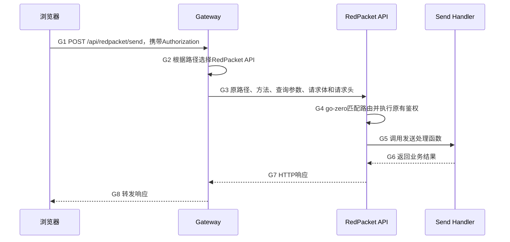

# 统一入口

网关监听 `127.0.0.1:10010`，按原路径转发请求：

| 入口路径 | 目标服务 |
|---|---|
| `/api/user/...` | User API `:8104` |
| `/api/offline/...` | Offline `:8105` |
| `/api/redpacket/...` | RedPacket API `:8103` |
| `/ws/chat` | Realtime `:9101` |

网关保留 HTTP 方法、路径、查询参数、请求体和 `Authorization` 头。各服务继续自行鉴权；网关不签发用户身份，也不参与消息与资金事务。目标地址见 [gateway.example.yaml](etc/gateway.example.yaml)。

从 `IM-learn` 目录启动开发入口：

```powershell
go run ./service/gateway -f service/gateway/etc/gateway.example.yaml
```

然后启动 `webark-im-template` 的 Vite 开发服务器。浏览器请求先到 Vite，Vite 将 `/api` 和 `/ws` 转发给网关；网关再选择后端服务。

使用已构建的前端时，先在 `webark-im-template` 目录运行 `node_modules/.bin/vite build`，再从 `IM-learn` 目录运行：

```powershell
go run ./service/gateway -f service/gateway/etc/gateway.example.yaml -static ../webark-im-template/dist/demo
```

打开 `http://127.0.0.1:10010/`。此时网关提供前端文件并转发 API 与 WebSocket。`-static` 只接受包含 `index.html` 的目录；未配置时网关仅转发请求。上游不可用返回 HTTP 502，未知 API 路径返回 404。

例如发送红包经过：浏览器 `POST /api/redpacket/send` → 网关 → RedPacket API `:8103` → go-zero 的发送 handler。WebSocket 建立经过网关，连接加入 Realtime 后由 Realtime 继续处理聊天消息。



G3 的目标服务未启动时，网关返回 502；路径不属于四个入口时返回 404。网关不改变业务成功条件，也不替下游服务确认事务结果。
